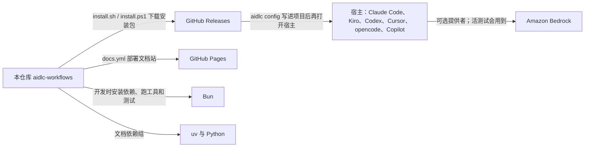
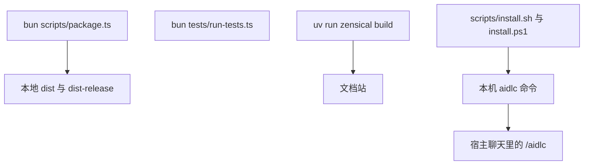

# 仓库第一遍地图

读者按刚入行、还没跑过这个项目来写。术语第一次出现时先用一句话说明。

## 门口与定位

这个仓库是 AI-DLC（AI-Driven Development Life Cycle，用固定阶段和人工确认来组织 AI 写软件的一套方法）的源码。它把同一套方法编成一个与具体聊天工具无关的核心，再投影到多种宿主里。【事实】`README.md` 开头与 `AGENTS.md`。

使用对象有两类。用它来做自己项目的人，按 README 安装本机命令 `aidlc`，再在宿主里用 `/aidlc` 描述要做的事。改这套方法本身的人，改 `core/` 和 `harness/<名字>/`，不要手改生成目录。【事实】`README.md` 的 Quick Start 与 Repository Layout；`CONTRIBUTING.md` 的 How this repository is built。

边界：仓库协议名以根目录 `LICENSE` 为准，是 MIT No Attribution（MIT-0）。版权属于 Amazon.com, Inc. 或其关联公司。【事实】`LICENSE` 第 1–3 行；`package.json` 的 `"license": "MIT-0"`。README 徽章也写 MIT-0。【事实】`README.md` 第 9 行。

它不自带一个常驻的业务网站或业务 API。文档站是另一条构建，见第 5 段。方法论本身不绑定某一家模型供应商；Amazon Bedrock 出现在可选的提供者设置和会花钱的活测试里。【事实】`README.md` 的 Recommended Model 附近「The methodology itself is provider-independent」；`tests/README.md` 的 Prerequisites。

## 形状与入口

顶层两级目录的职责，依据 `README.md` 的 Repository Layout、`AGENTS.md` 和目录列表。没有写明用途的标【未知】。

| 路径 | 职责 |
|---|---|
| `core/` | 手写的、与宿主无关的源。下面有 `tools/`（引擎和命令）、`aidlc-common/`（阶段与指挥人设）、`agents/`、`hooks/`、`knowledge/`、`memory/`、`scopes/`、`sensors/`、`skills/`、`templates/` |
| `harness/` | 每个宿主一份薄表面：`claude/`、`codex/`、`copilot/`、`cursor/`、`kiro/`、`kiro-ide/`、`opencode/`。各有清单和该宿主的 `/aidlc` 技能 |
| `plugins/test-pro/` | 可选插件机制的参考夹具。【事实】`AGENTS.md` |
| `scripts/` | 打包、安装脚本和发布工具。构建入口是 `scripts/package.ts` |
| `tests/` | 全是 TypeScript 的测试：`smoke/`、`unit/`、`integration/`、`e2e/`，另有 `fixtures/`、`harness/`、`hooks/`、`lib/` |
| `docs/` | `guide/` 给使用者，`harness-engineering/` 给改阶段和规则的人，`reference/` 给改引擎的人 |
| `assets/` | README 指向其中的方法规格 PDF。【事实】`README.md` Why AI-DLC |
| `.github/` | CI 工作流、Issue 与 Pull Request 模板、Dependabot、评审提示词 |
| `.learn/` | 本地学习材料，不是产品源码。【推断】依据目录里只有学习笔记，产品文档在 `docs/` |
| `.codegraph/` | 本次只看到它在仓库里。索引用途没有在门口文件里写明。【未知】 |

`package.json` 的名字是 `aidlc-workflows-dev`，`"private": true`，版本 `0.0.0`。说明写明：这是开发用工具包；生成后的发行物在 `dist/<宿主>/`，不靠这个私有包运行。【事实】`package.json` 的 `description`。

直接开发依赖（`devDependencies`）：`@anthropic-ai/claude-agent-sdk` 0.3.158、`@biomejs/biome` 2.4.16、`@xterm/headless`、`bun-types`、`eslint` 10.11.0、`smol-toml` 1.9.1、`typescript`。`overrides` 把 `proxy-addr` 固定为 2.0.8。【事实】`package.json`。文档构建另在 `pyproject.toml`：Python `>=3.12`，依赖组 `docs` 里是 `zensical==0.0.71`。【事实】`pyproject.toml`。

入口分三条，不要混成一个进程：

1. 聊天里的工作流入口是 `/aidlc`。Cursor 这份手写技能在 `harness/cursor/skills/aidlc/SKILL.md`，名字就是 `aidlc`。Codex 用 `$aidlc`。【事实】该文件前言；`README.md` 的 Pick your harness。
2. 本机命令 `aidlc` 负责安装后的配置、诊断和版本生命周期。配置实现在 `core/tools/aidlc-init.ts`（文件里多处处理 `config`）。安装脚本是 `scripts/install.sh` 和 `scripts/install.ps1`，默认从 GitHub Releases 下载。【事实】`docs/guide/12-cli-commands.md` 开头；`scripts/install.sh` 开头的 `RELEASE_REPOSITORY`。
3. 改这个仓库时的构建入口是 `scripts/package.ts`：把 `core/` 加 `harness/<名字>/` 生成到 `dist/` 和 `dist-release/`。【事实】该文件开头注释；`README.md` Development。

最近六个月（`git log --since=2026-05-17`）改动次数最多的 15 个路径。次数只说明提交碰过这些路径，不说明运行时行为。【事实】本地 `git log`。

| 次数 | 路径 |
|---|---|
| 661 | `core/tools/aidlc-lib.ts` |
| 586 | `core/tools/aidlc-orchestrate.ts` |
| 461 | `docs/reference/06-hooks-and-tools.md` |
| 368 | `docs/guide/12-cli-commands.md` |
| 339 | `core/tools/aidlc-utility.ts` |
| 314 | `README.md` |
| 294 | `docs/reference/12-state-machine.md` |
| 275 | `docs/reference/03-orchestrator.md` |
| 239 | `core/tools/aidlc-state.ts` |
| 234 | `tests/.coverage-registry.json` |
| 218 | `CHANGELOG.md` |
| 210 | `core/tools/aidlc-version.ts` |
| 199 | `dist/kiro/.kiro/tools/aidlc-version.ts` |
| 199 | `dist/codex/.codex/tools/aidlc-version.ts` |
| 199 | `dist/claude/.claude/tools/aidlc-version.ts` |

README 写 `dist/` 与 `dist-release/` 是生成物、不要手改、本地忽略。【事实】`README.md` Repository Layout。历史里仍出现三条 `dist/.../aidlc-version.ts`。这次没有核对它们现在是否仍被 git 跟踪。【未知】

## 上下文与主要部件

系统外部关系只画门口文件写明的外部系统。箭头是「文件里说谁连到谁」，不是一次调用的顺序。



图注：安装地址和宿主表在 `README.md`。文档站地址在 `zensical.toml` 的 `site_url`（`https://awslabs.github.io/aidlc-workflows/`）。文档工作流的构建命令在 `.github/workflows/docs.yml`。Bedrock 在 README 的排错表和 `tests/README.md` 的活测试前提里；同一段 README 写方法论不绑定供应商。

仓库里可以分开执行或分开部署的部分：



图注：打包、测试、文档构建是在这个仓库里敲的命令。`/aidlc` 不是本仓库单独拉起的服务，而是装进宿主之后在聊天里调用的技能。插件目录 `plugins/test-pro/` 是参考夹具，没有写成第四个要长期跑的服务。【事实】`AGENTS.md`。

## 一条主链路

主题名：`aidlc`。源码路径：`harness/cursor/skills/aidlc`；`core/tools/aidlc-orchestrate.ts`；`core/tools/aidlc-directive.ts`；`core/aidlc-common/conductor.md`。材料目录：`.learn/aidlc/`。

这条路径从 Cursor 里的 `/aidlc` 加上一段没有点名计划的描述开始。指挥技能把原文交给编排引擎的 `next`；空工作区上，引擎先请指挥提议计划，再打出一道要人确认的问句。

- [module-guide.md](../aidlc/module-guide.md)
- [execution-flow.md](../aidlc/execution-flow.md)
- [data-flow.html](../aidlc/data-flow.html)
- [exercises.md](../aidlc/exercises.md)

## 运行与测试说明书

下面每条命令都摘自文件。是否成功一律是「未跑」。没有在门口文件里看到本仓库要长期启动的业务服务；文档工作流只构建站点。【事实】`.github/workflows/docs.yml` 使用 `zensical build`，没有 `serve`。

安装依赖与生成各宿主树，摘自 `README.md` Development，同样见于 `docs/reference/11-contributing.md`：

```bash
bun install --frozen-lockfile
bun scripts/package.ts
```

未跑。

只生成一个宿主、以及两次构建必须字节相同的检查，摘自 `README.md` 与 `scripts/package.ts` 开头注释：

```bash
bun scripts/package.ts <name>
bun scripts/package.ts --check
```

未跑。

`package.json` 的 `scripts`：

```bash
bun run typecheck
bun run lint
bun run check
```

`typecheck` 是三份 `tsc --noEmit`。`lint` 是 `biome check`。`check` 是打包、确定性检查、类型检查和 lint 串在一起。未跑。`eslint` 在 `devDependencies` 里，`package.json` 的脚本没有调用它。谁在别的地方调用 eslint：【未知】。

测试，摘自 `README.md`、`CONTRIBUTING.md`、`docs/reference/11-contributing.md`、`tests/README.md`：

```bash
bun tests/run-tests.ts
bun tests/run-tests.ts --ci
bun tests/run-tests.ts --release
bash tests/run-tests.sh --ci
bash tests/run-tests.sh --smoke
bash tests/run-tests.sh --unit
bash tests/run-tests.sh --integration
bash tests/run-tests.sh --e2e
```

未跑。`tests/README.md` 写默认的 smoke、unit、integration 只需要 Bun；活测试还要对应宿主和凭证，缺了会跳过。

文档站，摘自 `.github/workflows/docs.yml`：

```bash
uv sync --locked --group docs
uv run zensical build --strict
```

未跑。

使用者安装（不是改这个仓库的循环），摘自 `README.md` Quick Start：

```bash
curl -fsSL https://github.com/awslabs/aidlc-workflows/releases/latest/download/install.sh | sh
```

```powershell
irm https://github.com/awslabs/aidlc-workflows/releases/latest/download/install.ps1 | iex
```

```bash
aidlc config --harness claude
aidlc doctor
```

未跑。把 `claude` 换成 `kiro`、`kiro-v2`、`codex`、`cursor`、`opencode` 或 `copilot` 是同一页写的。

值得先读的测试说明：`tests/README.md` 点名 `tests/unit/t-intent-grounding-regressions.test.ts`，并指向 `docs/reference/09-testing.md`。与这次 `/aidlc` 计划问句直接对应的测试文件，第一遍没有逐个打开。【未知】

## 工程约定

贡献入口是根目录 `CONTRIBUTING.md`。动手改代码前它要求再读 `docs/reference/11-contributing.md`。发布路径在 `DEVELOPERS.md`：Pull Request，到 AI 评审和 CI，到合并进 `main`，到预览，再到稳定发布。普通功能或修复不要改 `core/tools/aidlc-version.ts`、README 版本徽章和 `CHANGELOG.md` 的发布条目。【事实】`CONTRIBUTING.md` 的 Pull Request Checklist；`DEVELOPERS.md` 开头。

提交说明要求 conventional commits，例如 `feat:`、`fix:`、`docs:`。【事实】`CONTRIBUTING.md` Submitting your PR。

仓库里没有 `CODEOWNERS`。【事实】按该文件名查找为空。行为准则在 `CODE_OF_CONDUCT.md`，采用 Amazon Open Source Code of Conduct。

检查配置：`biome.json` 打开 linter、关掉 formatter。CI 工作流在 `.github/workflows/`，其中 `ci.yml`、`deterministic-tests.yml`、`full-suite.yml`、`docs.yml`、`security-scanners.yml`、`preview-release.yml`、`release.yml`、`promote-release.yml` 分别对应该文档里的检查、文档和发布。【事实】这些文件存在；各自完整步骤这次没有跑。Pull Request 模板在 `.github/pull_request_template.md`。Issue 模板在 `.github/ISSUE_TEMPLATE/`（bug、feature、rfc、documentation）。

变更记录在 `CHANGELOG.md`。当前第一条是 `## [2.11.4] - 2026-11-13`，兼容性行是 `Compatibility: breaking for scripts`。【事实】该文件开头。

在线的 Issue、Pull Request、Discussions、Release 活跃度：未做。没有打开这些页面。

安全问题不要开公开 Issue，按 `CONTRIBUTING.md` 的 Security issue notifications 报到 AWS 漏洞报告页。根目录没有 `SECURITY.md`。【事实】该节与文件查找。供应链发布说明在 `docs/reference/19-supply-chain-security.md`。

## 决策、空白与练习

没有名为架构决策记录的目录（查找 `docs/adr/` 为空）。分层和配置归哪一层，写在 `docs/reference/01-architecture.md`。第一遍没有把该章里的决策逐条摘出。

安全说明见上一段，加上 `docs/reference/19-supply-chain-security.md` 对预览、稳定发布和工作流权限的描述。

未知与未做：

- 命令是否能安装、打包、测试或构建文档：未跑。
- 在线社区是否活跃：未做。
- `{{INVOKE}}` 在装好的 Cursor 里换成哪条可执行命令：主链路标为未知。见 `.learn/aidlc/survey-notes.md`。
- 人同意计划之后，第一次阶段步骤怎样从阶段图选出：未知。同上。
- `core/tools/aidlc-orchestrate.ts` 开头注释写技能尚未调用该文件、框架行为不变；`docs/reference/03-orchestrator.md` 和技能正文写的是转发循环调用 `orchestrate next`。注释说的是源码文件没被技能 import，技能写的是命令名。安装后的命令是否落到这个文件：【未知】。本次没有运行。
- `eslint` 的实际调用点：【未知】。
- 历史里的 `dist/.../aidlc-version.ts` 现在是否仍被跟踪：【未知】。
- `.codegraph/` 的产品用途：【未知】。

仓库里另有 `.learn/人驱动一次工作/`。那份画像的源码路径更宽（含整个 `core/tools` 和 `core/aidlc-common`），水平是 modify。它不是这次第一遍选定的主链路。

下一条建议主题：`aidlc-config`。这是 README 里安装之后的下一条命令，负责把发行物写进项目并选定宿主。建议源码从 `core/tools/aidlc-init.ts`、`docs/guide/18-install-and-lifecycle.md`、`scripts/install.sh` 和 `scripts/install.ps1` 入手。另一条入口是打包：`scripts/package.ts`。两条都要等点名后再单独做，不要和这次的计划问句混在一份材料里。

### 练习

不改仓库。不附答案。

**题 1**

题目：只根据 `README.md` 的 Repository Layout，列出改这个产品时应该改的顶层目录，以及明确不要手改的目录。

验收：答案同时写出可改的 `core/`、`harness/<名字>/`，以及不要手改的 `dist/`、`dist-release/`，并注明依据是 README 的哪一节。

**题 2**

题目：`docs/guide/12-cli-commands.md` 开头说有两个用户可见的命令平面。用自己的话说明：本机的 `aidlc` 和聊天里的 `/aidlc` 各干什么，一个人第一次使用时 README 让他们先做哪一个。

验收：两个平面都说到，且能指出 README Quick Start 里配置命令出现在「打开宿主并输入 `/aidlc`」之前。不要求写出引擎内部步骤。

**题 3**

题目：读 `.learn/aidlc/module-guide.md` 开头的结论。说明这次主链路在哪一步停住，以及它明确不负责什么。

验收：停住点是一道让人确认计划的问句；不负责里至少包括「还不创建工作流」和「不替人把计划定死」。不要求背行号。
