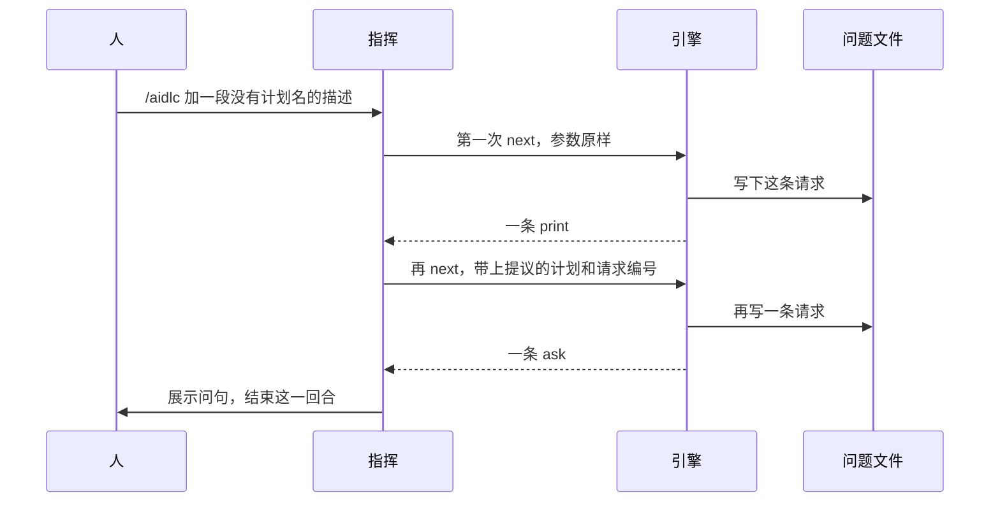

# 空工作区里的计划问句：字段怎么变

这份用一条示例走完字段变化。示例命令是 `/aidlc Build a notes app`。设计原因在文末的实现点；行号在每步的核对块。

## 示例约定

人在空工作区输入 `/aidlc Build a notes app`。`Build a notes app` 是要做的事，开头不是计划名。工作区里没有状态文件，也没有尚未选中的工作。指挥第一次把这段描述原样送进引擎。引擎请指挥提议一个计划。本示例里，指挥提议的计划用 `bugfix`：测试里第二次调用写的就是 `--propose bugfix`。然后引擎打出计划确认问句，这条路径停在这里。

两条问题的编号每次运行现铸，下面写成「第一次编号」和「第二次编号」，不填具体值。命令前面的那一截安装前缀，源码里仍是 `{{INVOKE}}`，装好的 Cursor 换成哪一串，这次不确定，所以只写 `next` 和它的旗标。

> 核对：指南把示例定成 `/aidlc Build a notes app`。技能里这几个词出现在「已经点了计划名」的例子旁边，例如 `next classic 'Build a notes app'`。本文件拿掉计划名来走「没有点名计划」这条路径。
> `harness/cursor/skills/aidlc/SKILL.md:47` 【事实】

> 推断：把这句描述和 `bugfix` 配在同一次走读上。依据是同一条路径的测试用另一句描述锁住两次调用，第二次提议的计划是 `bugfix`。
> `tests/unit/t-plan-question-waits-for-the-person.test.ts:39` `LINE` 【事实】
> `tests/unit/t-plan-question-waits-for-the-person.test.ts:123` `--propose bugfix` 【事实】

> 还不能确定：`{{INVOKE}}` 在装好的 Cursor 里换成哪条命令。

## 谁把工作交给谁

图上只画交接，不画字段。

> 核对：转发循环每次只收一条 JSON。`print` 照 `message` 做。`ask` 按选项展示并结束回合。
> `harness/cursor/skills/aidlc/SKILL.md:39` `The Forwarding Loop` 【事实】
> `harness/cursor/skills/aidlc/SKILL.md:89` `ask` 【事实】

## 逐步卡片

阶段名与指南「主路径索引」相同。

### 原样转发

- 这一步之后：人的描述还是一整段参数，指挥还没有拆旗标。
- 输入与输出：人的 `/aidlc Build a notes app` → 第一次 `next` 的参数仍是整段 `Build a notes app`。
- 变化的字段：还没有引擎里的字段。描述仍是一整段，旗标没有被指挥拆开。
- 源码：`harness/cursor/skills/aidlc/SKILL.md:39` `The Forwarding Loop`

> 核对：第一次 `next` 把 `$ARGUMENTS` 原样送进引擎。开头已经是计划名时，指挥才把那个名字拆成单独参数。本示例开头不是计划名，所以整段留下。
> `harness/cursor/skills/aidlc/SKILL.md:47` 【事实】

> 核对：第一次 `next` 返回之前，指挥先说一句关于人自己请求的话。这句话不改参数。
> `harness/cursor/skills/aidlc/SKILL.md:70` 【事实】

### 读成自由文本

- 这一步之后：这段参数变成工作描述，读法是自由文本。
- 输入与输出：整段 `Build a notes app` → `readNextLine` 给出 `{ kind: "words" }`，`flags.intent` 写成 `Build a notes app`。
- 变化的字段：一整段参数收成 `flags.intent`。读法是 `words`。这里还不写问题文件，也没有计划名。
- 源码：`core/tools/aidlc-lib.ts:40012` `readNextLine`

> 核对：`parseNextFlags` 把这一行交给 `readNextLine`。`words` 不走早退。剩下的词写成 `flags.intent`，并去掉开头的入口词。
> `core/tools/aidlc-orchestrate.ts:6976-6985` `parseNextFlags` 【事实】
> `core/tools/aidlc-orchestrate.ts:7423-7424` 【事实】

> 推断：`Build` 不在这次要对照的计划名里，所以不是 `plan-word`，也不是整行就是计划名的 `exact`。依据是技能把 `classic` 这类词当计划名，本示例按指南选定为没有计划名。若某次安装的名单里真有 `Build`，读法会离开这条路径。

> 还不能确定：代理已经传入描述时，`takePersonsOwnLine` 会不会再改 `flags.intent`。替换条件没有逐支读完。
> `core/tools/aidlc-orchestrate.ts:11836` `takePersonsOwnLine` 【事实】

### 存下空计划的请求

- 这一步之后：描述落成一条问题文件，来源是开工前的请求，计划名还是空的。
- 输入与输出：`flags.intent` 为 `Build a notes app` → 一条问题：`text` 是这段描述，`origin` 是 `front`，`proposedScope` 是空字符串，`proposal` 是 true。
- 变化的字段：自由文本变成文件。新出现 `id`、`origin`、`proposedScope`、`proposal`、`createdAt`。`proposedScope` 仍是空的。
- 源码：`core/tools/aidlc-orchestrate.ts:7667` `saveQuestion`

> 核对：空工作区、没有状态文件、没有 `--scope`、也没有位置上的计划名时，Branch 8 进入 `freshWorkRoute`。还没有 `--propose` 时，它调用 `planProposalDirective`。那里用 `saveQuestion` 把计划名存成空字符串，来源是 `front`，最后一个参数 `true` 写上 `proposal`。
> `core/tools/aidlc-orchestrate.ts:13703-13713` `routeNext` 【事实】
> `core/tools/aidlc-orchestrate.ts:7810-7811` `freshWorkRoute` 【事实】
> `core/tools/aidlc-orchestrate.ts:7667-7669` `planProposalDirective` 【事实】
> `core/tools/aidlc-question-store.ts:504-518` `saveQuestion` 【事实】

> 核对：本示例没有未选中的工作，也没有已完成的工作要先读。若工作区里已经有未选中的工作，Branch 8 前面的分支会先问选哪一份，到不了这一步。
> `core/tools/aidlc-orchestrate.ts:13691-13700` 【事实】

### 打出提议步骤

- 这一步之后：下一步变成一条 `print`，请指挥提议计划，并带上这条问题的编号。
- 输入与输出：刚存下的那条空计划请求 → `{ kind: "print", message }`。`message` 请指挥读描述、提议一个计划，再跑 `next --propose <plan> --request` 加上第一次编号。
- 变化的字段：指挥收到的对象从「还没有指令」变成 `kind` 为 `print`。问题文件的字段没变，它的 `id` 写进了 `message`。
- 源码：`core/tools/aidlc-orchestrate.ts:7681` `printDirective`

> 核对：`printDirective` 只放 `kind` 和 `message`。`message` 写明：没有现成计划就改跑 `--propose compose`；指挥不得自己创建工作流。计划名单由 `planChoicesLine` 拼进同一段 `message`，名单内容随安装变化，这里不填具体列表。
> `core/tools/aidlc-orchestrate.ts:5294-5296` `printDirective` 【事实】
> `core/tools/aidlc-orchestrate.ts:7682-7686` 【事实】
> `core/tools/aidlc-orchestrate.ts:7694` `planChoicesLine` 【事实】

> 核对：这条 `print` 打出前同样经过校验。它不结束回合：`message` 要指挥再跑一次 `next`。索引里的「校验后结束回合」指后面那条问句。
> `core/tools/aidlc-orchestrate.ts:2121-2127` `validateDirective` 【事实】
> `harness/cursor/skills/aidlc/SKILL.md:82` `print` 【事实】

### 按请求读回

- 这一步之后：同一条问题被读回来，确认它仍是没有计划名的开工请求。
- 输入与输出：`next --propose bugfix --request` 加上第一次编号 → 读回的仍是那条 `origin` 为 `front`、`proposedScope` 为空的问题；描述改从文件的 `text` 取回。
- 变化的字段：问题文件没改。这次调用多了 `--propose bugfix` 和 `--request`。`flags.intent` 被设成文件里的 `text`。空的 `proposedScope` 不会写成 `flags.scope`。
- 源码：`core/tools/aidlc-orchestrate.ts:12152` `readQuestion`

> 核对：`origin` 为 `front` 且 `proposedScope` 仍空时，调用 `freshWorkOfferDirective` 并返回。`flags.intent` 在这之前被换成 `found.text`。
> `core/tools/aidlc-orchestrate.ts:12180-12189` 【事实】
> `core/tools/aidlc-question-store.ts:240` `readQuestion` 【事实】

> 推断：本示例用 `bugfix` 作为指挥提议的计划，依据见上面的示例约定。

### 存下计划确认

- 这一步之后：另存一条写上所提议计划的问题文件，问句指向这条新编号。
- 输入与输出：空计划的旧请求，加上提议 `bugfix` → 新的一条问题，`proposedScope` 为 `bugfix`，`text` 仍是 `Build a notes app`，`composedFrom` 指向第一次编号；`ask` 的 `question_id` 是第二次编号。
- 变化的字段：新文件的 `proposedScope` 写成 `bugfix`。问句编号改用新的 `id`。第一条的 `proposedScope` 仍是空的。
- 源码：`core/tools/aidlc-orchestrate.ts:3927` `saveQuestion`

> 核对：提议的不是 `compose` 时，`freshWorkOfferDirective` 调用 `scopeConfirmAskDirective`。新文件的来源仍是 `front`。`question_id`、`confirm_command`、`compose_command` 都用新编号。本示例没有另带深度或测试策略，这两条命令后面不再接那些旗标。
> `core/tools/aidlc-orchestrate.ts:7595-7612` `freshWorkOfferDirective` 【事实】
> `core/tools/aidlc-orchestrate.ts:3927-3951` `scopeConfirmAskDirective` 【事实】
> `core/tools/aidlc-orchestrate.ts:3663-3676` `carriedCreationFlags` 【事实】
> `core/tools/aidlc-orchestrate.ts:7556-7557` `typedStageAnswers` 【事实】

> 核对：三个选项是：按 `bugfix` 做（命令是 `next --scope bugfix --request` 加上第二次编号）、换一个计划（没有命令）、按这个任务另做一份计划（命令是 `next compose --request` 加上第二次编号）。问句正文此步还没有补上。
> `core/tools/aidlc-orchestrate.ts:3948-3951` 【事实】

### 补上问句正文

- 这一步之后：这条 `ask` 带上给指挥看的短注，以及带编号的正文。
- 输入与输出：上一步的 `scope-confirm` 问句 → 同一条问句，多了 `question_note` 和 `numbered_prose_question`。
- 变化的字段：新增 `question_note` 和 `numbered_prose_question`。三个选项的 `label` 和命令不变。
- 源码：`core/tools/aidlc-directive.ts:1865` `withAgentNotes`

> 核对：`scope-confirm` 的短注来自 `planOfferQuestionNote`。已有 `choices` 时不再另造选项。编号正文用 `numberedProseQuestion`：问句下面是三个选项，再加一行 Other，最后是回复提示。引擎拥有这些编号。
> `core/tools/aidlc-directive.ts:1854-1876` `withAgentNotes` 【事实】
> `core/tools/aidlc-directive.ts:1362-1365` `planOfferQuestionNote` 【事实】
> `core/tools/aidlc-directive.ts:1720-1722` `numberedProseQuestion` 【事实】

> 核对：`prepareEmission` 在校验之前调用 `withAgentNotes`。
> `core/tools/aidlc-orchestrate.ts:2068-2070` 【事实】

### 校验后结束回合

- 这一步之后：标准输出一条计划确认问句；指挥按三个选项展示，然后结束这一回合。
- 输入与输出：补过正文的 `ask` → 校验通过后，标准输出上一行 JSON；指挥展示问句并结束回合。
- 变化的字段：问句字段不再增加。输出位置变成标准输出，并且这一回合在问句上停下。
- 源码：`core/tools/aidlc-orchestrate.ts:2121` `validateDirective`

> 核对：`kind` 必须是允许的种类之一，多余的键会被拒绝。不合法就写到错误输出并退出，标准输出上没有这条指令。合法则 `writePrepared` 把序列化结果写到标准输出。
> `core/tools/aidlc-directive.ts:1972-1990` `validateDirective` 【事实】
> `core/tools/aidlc-orchestrate.ts:2121-2128` 【事实】
> `core/tools/aidlc-orchestrate.ts:2410-2411` `writePrepared` 【事实】

> 核对：`ask` 要按给出的选项展示，然后结束回合。这是这条路径上第一次要人回答的下一步。
> `harness/cursor/skills/aidlc/SKILL.md:89` 【事实】

> 推断：打出前还有几层包装。本示例没有逐项展开包装后是否再添字段，所以不把「标准输出只有卡片里这些键」写成事实。依据是 `prepareEmission` 在校验前还会处理保留下来的回复，并把人的话放在前面；这条 `ask` 不是 `run-stage`，阶段运送那一层不会走。这次确认了的是问句短注和编号正文。

## 这条路径上的出口

| 如果 | 停在哪 | 有没有回合结束事件 |
|---|---|---|
| 工作区里已有未选中的工作 | 先问选哪一份，进不了上面的卡片 | 那条自己的问句会结束回合；这条路径还没开始 |
| 描述开头已经是计划名 | 走向创建，不先问这道计划题 | 这次不沿那条看 |
| 第一次或第二次的指令校验失败 | 错误输出，进程退出，标准输出没有指令 | 没有问句回合 |
| `--propose` 缺计划名、缺 `--request`，或名字不在名单里也不是 `compose` | 一条说给指挥的 `print`，要求按原命令重跑 | 没有。这不是打给人的报错 |
| 按编号读不到那条问题 | 一条 `error`，或「这是重复回答」的指令 | `error` 要停下 |
| 指挥提议的是 `compose` | 另一条问句，问要不要另做一份计划 | 有。指挥展示后结束回合。这次不沿那条看 |
| 问句校验通过 | 标准输出上的计划确认问句 | 有。指挥展示三个选项后结束回合 |

> 核对：未选中工作、计划名开头、校验失败、`--propose` 的三种缺口、读不到问题、`compose`，分别在下面这些位置返回。
> `core/tools/aidlc-orchestrate.ts:13691-13700` 【事实】
> `core/tools/aidlc-lib.ts:40008-40012` 【事实】
> `core/tools/aidlc-orchestrate.ts:2122-2126` 【事实】
> `core/tools/aidlc-orchestrate.ts:12086-12107` 【事实】
> `core/tools/aidlc-orchestrate.ts:12153-12156` 【事实】
> `core/tools/aidlc-orchestrate.ts:7595-7630` 【事实】

## 实现点

### 1. 指挥为什么不自己拆旗标

人可以在 `/aidlc` 后面写计划名、旗标，或一整段要做的事。两处各读一遍，就会对「这是计划名还是句子」得出两个答案。

引擎只在 `readNextLine` 里决定这一行怎么读。指挥把参数原样送进去。唯一先看一眼的情况是：开头那个词已经是计划名。那时指挥把名字拆成单独参数，免得再问人一个已经说了的计划。

另一种做法是让指挥解析全部旗标。代价是技能和引擎各有一份读法，改一边时另一边会悄悄分叉。现在的代价是指挥仍要认识「开头是不是计划名」这一件事。

常见误区：看到「原样」就以为计划名也粘在句子里。那样引擎会把人已经点名的计划再问一遍。

验证：描述是 `/aidlc classic Build a notes app` 时，第一次 `next` 之前，指挥要先把哪个词拆出去？

> 核对：原样转发，以及计划名开头才拆开，写在转发循环那一段。
> `harness/cursor/skills/aidlc/SKILL.md:47` 【事实】

### 2. 为什么先请指挥提议，而不是引擎自己选计划

工具不读这段描述在说什么。空工作区里又没有点名计划时，引擎不能自己挑下一步。

所以它先把原话存下来，计划名留空，再打一条 `print`，把安装里的计划名单交给指挥。指挥读过描述，用 `--propose` 提议一个计划。空的 `proposedScope` 让同一次请求再跑时，仍认出「还没有计划」，从而回到同一次提议，而不是直接去问人。

旧做法是引擎按关键词选一个计划，直接拿去确认。注释写明现在改成由指挥提议，避免静默默认。代价是人要等两次引擎调用才看见问句；第一次看见的是给指挥的 `print`，不是给人的题。

常见误区：把这条 `print` 当成已经在问人。它是在吩咐指挥去提议。

验证：第一次存档时 `proposedScope` 若已经写上某个计划名，第二次带 `--propose` 的 `next` 还会不会走进 `freshWorkOfferDirective`？

> 核对：`planProposalDirective` 的注释写明工具不读请求的意思，提议由指挥来做。空的 `proposedScope` 用来复用同一条提议。
> `core/tools/aidlc-orchestrate.ts:7645-7666` 【事实】

> 推断：注释里的「旧的静态默认确认」是这次改动的原因。代码里能看到的是现在这条提议路径。

### 3. 为什么问句另存一条，编号用新的

同一次描述会留下两条问题文件。问两次就是两条问题，各有自己的编号和文件。

第一条给指挥提议用，计划名是空的，并标着 `proposal`。第二条在指挥提议之后另存，写上 `bugfix` 这种计划名。问句的 `question_id` 和「就用这个计划」的命令都用第二条，因为人要确认的是已经写上计划名的那份。`composedFrom` 指回第一条，人原来的话仍在一跳之内。

另一种做法是在第一条上直接改 `proposedScope`。代价是提议用的请求和人要回答的问题挤在同一个编号里，命令更容易答到还没写上计划名的那份。

常见误区：把 `print` 里那个编号当成问句编号。同意时命令上的 `--request` 是第二条。

验证：`confirm_command` 里的 `--request` 是第一次编号，还是第二次编号？

> 核对：`saveQuestion` 的注释写明问两次就是两条问题。`question_id` 用的是这次 `saveQuestion` 返回的 `id`。
> `core/tools/aidlc-question-store.ts:474-476` 【事实】
> `core/tools/aidlc-orchestrate.ts:3927-3937` 【事实】

### 4. 为什么「换一个计划」没有命令

三个选项里，中间那个没有 `command`。人选它的时候，计划名还不知道，引擎没法先写好一条 `next --scope`。

短注要求指挥把这一步已经列好的计划名单（每个计划带自己的阶段数）再展示成编号列表，等人点名之后，再跑那一条计划自己的命令。名单在 `scope_commands` 里，不在这三个 `choices` 的中间那条上。

另一种做法是第一次问句就把每个计划都变成一个选项。代价是名单一长，问句就不再是「这个计划、换一个、或另做一份」这三选一。

常见误区：没有命令等于这个选项作废。它是在要一个还没说出口的计划名。

验证：人选了「换一个计划」之后，指挥要展示的名单来自问句上的哪个字段？

> 核对：中间选项不带 `command`。注释写明要等人点名，短注让指挥展示这一步列出的计划。
> `core/tools/aidlc-orchestrate.ts:3942-3951` 【事实】
> `core/tools/aidlc-directive.ts:1360-1365` `planOfferQuestionNote` 【事实】

### 5. 为什么编号正文由引擎补上

Cursor 这条路径没有单独的结构化提问工具可用时，人看到的是一段带编号的话。回复里的「2」必须对上同一次打出的顺序。

引擎在打出前用 `numberedProseQuestion` 写上 `numbered_prose_question`。三个 `choices` 各占一行，后面再加一行 Other。指挥按给出的这段展示，不再自己编号，也不再加一个选项。

另一种做法是只靠技能里的 `ask` 那一行，让指挥自己排版。代价是技能和引擎对「2 是哪一项」会各说各的。

常见误区：屏幕上只有三个选项。编号正文还会多一行 Other。那一行不是第四个带命令的 `choices` 元素。

验证：编号 2 对应哪一个 `label`，是谁决定的？

> 核对：引擎拥有编号；`withAgentNotes` 在字段还不是字符串时写入编号正文。
> `core/tools/aidlc-directive.ts:1701-1722` 【事实】
> `core/tools/aidlc-directive.ts:1874-1876` 【事实】
> `core/tools/aidlc-directive.ts:668-672` 【事实】

### 6. 为什么这两次指令不带人设

人设正文在 `conductor.md`。文件开头写的是把它烤进会话的第一次 `next`。这条路径的 `print` 和 `ask` 上没有 `conductor_persona`。

代码把这个字段挂在构造 `run-stage` 的时候，并且要求这是工作流里第一次实质阶段步骤。没有状态文件时，这个判断为 false，初始化阶段也不挂。计划问句发生在创建工作流之前，所以这两次打出不读人设文件。

另一种做法是每次 `next` 都带上人设，包括这次问句。代价是问句指令变长，而且 Cursor 这条注释写明命令不带聊天名，人设只送一次，不按聊天重复。

常见误区：按文件开头，到第一次 `print` 里找人设。挂载点以引擎为准。

验证：没有状态文件时，`isFirstRunStageOfWorkflow` 返回什么？`conductor_persona` 写在哪种 `kind` 上？

> 核对：文件开头与挂载点不是同一句。字段声明写的是工作流的第一次 `run-stage`。
> `core/aidlc-common/conductor.md:9-13` 【事实】
> `core/tools/aidlc-orchestrate.ts:9081-9101` `readConductorPersona` 【事实】
> `core/tools/aidlc-orchestrate.ts:9298-9317` `isFirstRunStageOfWorkflow` 【事实】
> `core/tools/aidlc-directive.ts:514-519` 【事实】

> 推断：计划问句这两次 `next` 不带 `conductor_persona`。依据是挂载点只在 `run-stage` 构造里，且没有状态文件时该判断为 false。

## 异常、测试与风险

### 已由代码确认的行为

- 每次 `next` 只打出一条指令。校验失败就写错误输出并退出，不把不合规格的对象打到标准输出。
- `--propose` 的形状不对时，返回给指挥的是 `print`，不是打给人的 `error`。
- 「换一个计划」这个选项没有命令。
- 同意所用的命令形状是 `next --scope <计划> --request <第二次编号>`。同意之后如何创建，这次没有往下读。
- 存在覆盖这条两次调用的测试，例如 `tests/unit/t-plan-question-waits-for-the-person.test.ts`、`tests/unit/t-newest-request-wins.test.ts`，以及 `tests/harness/fixtures.ts` 里的 `planOffer`。没有运行它们。

要保住的关系：空的 `proposedScope` 加上 `origin` 为 `front`，第二次才进入计划确认；问句编号是第二条文件的编号；指挥在这条 `print` 上不得自己创建工作流。

改动后应回归：上面三个测试文件里「提议计划」和「问句要等人回答」的用例。这次没有运行。

### 尚未验证、值得检查的风险

- 这些测试现在是否通过。
- 源码里的 `{{INVOKE}}` 在 Cursor 安装里换成哪条命令。
- 代理已经传入描述时，`takePersonsOwnLine` 会不会改写 `flags.intent`。
- `prepareEmission` 在短注之外还会不会给这条 `ask` 再加字段。这次没有把包装逐项读完。
- 人同意之后，第一次阶段步骤怎样从阶段图里选出来。

### 不影响正确性的改进

人设文件开头和引擎挂载点不是同一句。读这条路径时，容易到 `print` 上找人设。把文件开头改成「工作流已经存在之后的第一次实质阶段步骤」，能少一次误读。这不改变问句本身对不对。
