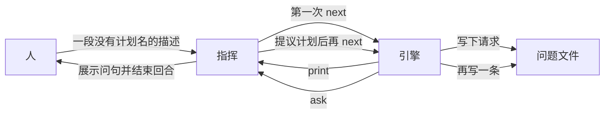

# aidlc：空工作区里的计划问句

## 打开顺序

这份指南只回答一件事：空工作区里，一段没有计划名的描述，怎样变成一条要人确认计划的问句。

示例命令是 `/aidlc Build a notes app`。这里的 `Build a notes app` 是要做的事，开头没有 `classic` 这类计划名。字段一步步变成什么，写在执行路径里，不在这里展开。

先读本文件的八条结论和主路径索引。`survey-notes.md` 是证据索引，不是讲义。每节的核对写在该节末尾；边界、未知和文件优先级写在文末「核对与未知」。

## 八条结论

1. 人在空工作区说了要做什么，描述里又没有点名计划时，指挥不能自己选下一步。引擎先请指挥提议一个计划，再把「用不用这个计划」问给人。
2. 这条路径负责到打出一条校验过的计划确认问句。人同意之后怎样创建工作流，这次停在问句上，不往下走。
3. 输入是 `/aidlc` 后面整段描述。第一次引擎给出的是一条 `print`：请指挥读描述、提议计划，再带上请求编号跑下一次。第二次的输出是一条 `ask`，给人三个选项。
4. 这条路径不创建工作流，不替人选定计划，也不把指挥人设放进这两条指令。安装、打包、另做一份计划、手里已经有工作，都不在这次要走的路上。
5. 还不能确定三件事：源码技能里的 `{{INVOKE}}` 在装好的 Cursor 里换成哪条命令；第一次 `next` 会不会按人自己打的那一行改描述的用字（这次没有那条会话记录）；人同意之后，第一次阶段步骤怎样从阶段图里选出来。现有测试没有运行。
6. 记录有两类，顺序固定。引擎先把描述写成一条问题文件，再打出指向它的指令。第一次文件里的计划名是空的，打出的是 `print`。第二次另存一条写上所提议计划的文件，打出的是 `ask`，问句编号是第二条文件的编号。
7. 人设正文在 `conductor.md`，送达时机以引擎挂载点为准。文件开头写的是烤进会话的第一次 `next`；代码把它挂在已经有工作流之后的第一次实质阶段步骤上。这条路径的 `print` 和 `ask` 不带这份人设。
8. 描述开头如果已经是计划名，引擎不会先问这道题，而会走向创建。这次要学的是没有计划名的那条描述。

## 阅读路线

可用时间按 1–3 小时。阶段 5 可以整段跳过。阶段 4 只看测试在锁哪一步，不改代码。

### 阶段 1：建立整体认知

- 阅读位置：本文件的八条结论、运行时协作、主路径索引。
- 要回答：空工作区里谁决定下一步？这条路径停在哪一句问话？
- 预计耗时：20 分钟。
- 验收：能用自己的话说出「先提议计划，再问人」，并说出停在计划确认问句，创建还没开始。

### 阶段 2：读关键接口

- 阅读位置：下面六个符号。`routeNext` 和 `readNextLine` 决定一行怎么读；`planProposalDirective` 和 `scopeConfirmAskDirective` 造出两条指令；`saveQuestion` 把请求存下来；`validateDirective` 在打出前检查形状。
- 要回答：自由文本在哪一次被收成描述？空计划的请求和带计划名的问句，各是哪一次 `saveQuestion`？
- 预计耗时：40 分钟。
- 验收：能指出第一次存档时计划名为空，第二次存档时计划名是指挥提议的那个，并且问句编号用的是第二次的编号。

### 阶段 3：追踪一条真实路径

- 阅读位置：`execution-flow.md` 里与下面「主路径索引」同名的卡片，从「原样转发」走到「校验后结束回合」。
- 要回答：示例 `/aidlc Build a notes app` 走完后，人看到的三个选项分别会带上什么命令？
- 预计耗时：40 分钟。
- 验收：能按索引的八个阶段名讲完，并说清「换一个计划」那个选项没有命令。时间不够时，先只背索引里每一行「这一步之后」的那句，执行路径留到下一小时。

### 阶段 4：读测试，先不改代码

- 阅读位置：`tests/unit/t-plan-question-waits-for-the-person.test.ts`、`tests/unit/t-newest-request-wins.test.ts` 的文件头，以及 `tests/harness/fixtures.ts` 里调用 `next --propose` 的那一段。
- 要回答：这些测试在锁「问句要等人回答」，还是在锁人同意之后的创建？
- 预计耗时：20 分钟。
- 验收：能说出至少一个测试文件名，并说明这次材料没有运行它们。不要求改代码。

### 阶段 5：按目标决定是否扩展

- 阅读位置：文末「核对与未知」里的暂不展开。
- 要回答：下一步若要看「人同意这个计划之后」，应该从哪个符号接着读？
- 预计耗时：15 分钟。时间不够可以整段跳过。
- 验收：能说出同意对应的命令是 `next --scope <计划> --request <id>`，创建打印在 `createPrintDirective`，这次还没有沿那条读完。

## 运行时协作

谁把工作交给谁。这张图不画类型关系，也不画字段变化。

指挥只转发参数，并照引擎给的那一条去做。引擎决定下一步，并把请求写进问题文件，好让下一次用短编号接回同一段描述。安装里的计划名单可以单独换成另一套范围，`print` 里列出的计划会跟着变，先问再确认的顺序还在。改问题文件的字段时，会同时碰到存档、第二次 `next` 怎么判断「还没有计划」，以及问句上的编号。

> 核对：转发循环把 `$ARGUMENTS` 原样送进 `next`，每次只收一条 JSON。`print` 照 `message` 做，`ask` 按选项展示并结束回合。
> `harness/cursor/skills/aidlc/SKILL.md` `The Forwarding Loop`、`Acting on a step` 【事实】

> 核对：空工作区、没有计划名时，Branch 8 进入 `freshWorkRoute`；还没有 `--propose` 时返回 `planProposalDirective`。带 `--propose` 且读回的是空计划的 front 问题时，返回 `freshWorkOfferDirective`，再得到 `scopeConfirmAskDirective`。
> `core/tools/aidlc-orchestrate.ts` `routeNext`、`freshWorkRoute`、`planProposalDirective`、`freshWorkOfferDirective`、`scopeConfirmAskDirective` 【事实】

> 推断：计划名单能单独替换，依据是 `planChoicesLine` 用 `validScopes` 和 `loadScopeMetadata` 拼进 `print`，路由不在名单函数里。

## 主路径索引

阶段名在这里定下。执行路径的卡片使用相同标题。每一行只写这一步之后业务对象变成什么。

1. 原样转发：人的描述还是一整段参数，指挥还没有拆旗标。
2. 读成自由文本：这段参数变成工作描述，读法是自由文本。
3. 存下空计划的请求：描述落成一条问题文件，来源是开工前的请求，计划名还是空的。
4. 打出提议步骤：下一步变成一条 `print`，请指挥提议计划，并带上这条问题的编号。
5. 按请求读回：同一条问题被读回来，确认它仍是没有计划名的开工请求。
6. 存下计划确认：另存一条写上所提议计划的问题文件，问句指向这条新编号。
7. 补上问句正文：这条 `ask` 带上给指挥看的短注，以及带编号的正文。
8. 校验后结束回合：标准输出一条计划确认问句；指挥按三个选项展示，然后结束这一回合。

## 概念卡片

类型之间谁实现谁、谁包含谁、谁引用谁，见 `structure.md`。这里不重复那张图。

### 指挥

结论：指挥是 Cursor 里响应 `/aidlc` 的那份技能，它负责把参数送进引擎，并照引擎返回的那一条去做。

白话：指挥像传话的人。它不决定下一次该创建、该问人，还是该做某个阶段。

在这条路径上：第一次它把整段描述原样送进去；拿到 `print` 后按其中的命令再跑一次；拿到 `ask` 后把问句给人看，并结束回合。

最容易误用：看到 `print` 里的计划列表，就自己挑一个并创建工作流。列表是给它提议用的，选定要等人回答。

> 核对：入口名是 `/aidlc`。转发循环从 `/aidlc` 被调用时开始，不预先拆旗标；开头是计划名时才把那个名字拆成单独参数。
> `harness/cursor/onboarding.fills.ts` `invoke` 【事实】
> `harness/cursor/skills/aidlc/SKILL.md` `The Forwarding Loop` 【事实】

> 核对：第一次 `next` 返回前，先说一句关于人自己请求的话。
> 同文件 “the very first turn” 【事实】

### 指令

结论：指令是引擎一次 `next` 打到标准输出的那一条 JSON。这条路径上先是 `print`，后是 `ask`。

白话：指令就是「下一步只做这一件」。`print` 是照着一段话去做；`ask` 是把题给人，然后停下来等。

在这条路径上：`print` 让指挥提议计划。`ask` 的类型是计划确认，三个选项是按该计划做、换一个计划、按这个任务另做一份。换计划那个选项没有命令。

最容易误用：把 `ask` 当成指挥可以自己回答的提示。技能要求按给出的选项展示，然后结束回合。

> 核对：`print` 只有 `kind` 和 `message` 由 `printDirective` 填上。计划确认 `ask` 的 `ask_type` 是 `scope-confirm`，`response_route` 是 `next`，三个 `choices` 里中间那个没有 `command`。
> `core/tools/aidlc-orchestrate.ts` `printDirective`、`scopeConfirmAskDirective` 【事实】
> `core/tools/aidlc-directive.ts` `PrintDirective`、`ScopeConfirmAskDirective` 【事实】

> 核对：打出前 `withAgentNotes` 给非指挥自己干活的 `ask` 写上 `question_note`；计划确认用计划问句那条注。已有选项时写上 `numbered_prose_question`。随后 `validateDirective` 不通过就写到错误输出并退出，不打出指令。
> `core/tools/aidlc-directive.ts` `withAgentNotes`、`numberedProseQuestion`、`validateDirective` 【事实】
> `core/tools/aidlc-orchestrate.ts` `prepareEmission`、`emit`、`writePrepared` 【事实】

### 计划

结论：这里的计划是一套已经装好的阶段范围，用短名字称呼，例如技能举例里的 `classic`。

白话：计划决定这次工作大概会经过哪些站。人还没点名时，引擎不默认替人选一套。

在这条路径上：自由文本不会被当成计划名。指挥提议一个名字之后，问句里的「按该计划做」才会带上 `next --scope <计划> --request <id>`。

最容易误用：把它当成 Code Generation 里那份等批准的实现计划。那是另一条路径，名字也叫计划，问的不是开工前用哪套范围。

> 核对：整行不是已安装计划名、也不是「计划名加一个带空格的参数」时，`readNextLine` 返回 `kind: "words"`。松散接在计划名后面的句子是 `plan-word`，那条不在这次主路径上。
> `core/tools/aidlc-lib.ts` `readNextLine` 【事实】

> 核对：`words` 不走早退，剩下的词写入 `flags.intent`。没有状态文件、没有范围、也没有位置上的计划名时，才进入 Branch 8。
> `core/tools/aidlc-orchestrate.ts` `parseNextFlags`、Branch 8 【事实】

> 核对：同意所用的命令是 `next --scope <计划> --request <id>`。没有状态且范围来自旗标时，Branch 9a 走 `createPrintDirective`。这次没有沿创建之后怎样选出第一次阶段步骤读完。
> `core/tools/aidlc-orchestrate.ts` `confirmCommand`、Branch 9a 【事实】

### 问题文件

结论：问题文件是引擎为这次请求留下的副本。后面的命令用短编号指它，不再把整段描述贴回去。

白话：它像一张取号条。描述正文在文件里，命令行上只带编号。

在这条路径上：`print` 和 `ask` 都靠这个编号接回同一次请求。两条文件的差别见 `structure.md` 的实体图。

最容易误用：指挥自己去读或改 `aidlc/.aidlc-sessions/questions/` 里的文件，或把描述正文再贴进下一次命令。技能写明不要读、不要改、不要用正文替换编号。

> 核对：`saveQuestion` 写入 `StoredQuestion`，文件在会话目录的 `questions/<id>.json`。`readQuestion` 按编号读回；已回答或过了保留期的读回是空。
> `core/tools/aidlc-question-store.ts` `StoredQuestion`、`saveQuestion`、`readQuestion`、`questionRel` 【事实】
> `harness/cursor/skills/aidlc/SKILL.md` Question transport 【事实】

> 核对：第一次 `planProposalDirective` 以空计划名、来源 `front`、`proposal` 为真来存。第二次 `scopeConfirmAskDirective` 再存一条，计划名是提议的那个，`composedFrom` 指向第一条，问句的 `question_id` 是第二条的编号。
> `core/tools/aidlc-orchestrate.ts` `planProposalDirective`、`scopeConfirmAskDirective` 【事实】

### 人设

结论：人设是 `conductor.md` 里那份「阶段要怎样做好」的说明。引擎在第一次实质阶段步骤上把它放进指令，这条计划问句不放。

白话：人设告诉指挥怎样把一个阶段做扎实。它不是下一步走哪条路由的说明书，路由仍由引擎决定。

在这条路径上：工作流还不存在，所以两次 `next` 的指令里都没有 `conductor_persona`。

最容易误用：按文件开头那句，认为第一次 `next` 的 `print` 或 `ask` 里就已经带着全文。

> 核对：`readConductorPersona` 读 `aidlc-common/conductor.md`，文件缺失就返回空，不因此失败。`conductor_persona` 在构造 `run-stage` 时挂上，条件包括 `isFirstRunStageOfWorkflow`。没有状态文件时该函数返回假，初始化阶段也返回假。
> `core/tools/aidlc-orchestrate.ts` `readConductorPersona`、`isFirstRunStageOfWorkflow` 【事实】
> `core/tools/aidlc-directive.ts` `RunStageDirective.conductor_persona` 【事实】

> 核对：`conductor.md` 文首写引擎把它烤进会话的第一次 `next`，技能不按路径引用它。
> `core/aidlc-common/conductor.md` 文首 【事实】

> 推断：计划问句这两次 `next` 不带 `conductor_persona`。依据是挂载点只在 `run-stage` 的构造里，且没有状态文件时第一次实质阶段的判断为假。

> 核对：Cursor 这条注释写命令不带聊天名，因此人设只送这一次，不按聊天重复。那一次仍是阶段步骤，不是这次的计划问句。
> `core/tools/aidlc-orchestrate.ts` `isFirstRunStageOfWorkflow` 上方注释 【事实】

## 核对与未知

### 边界六问

1. 边界：从 Cursor 里的 `/aidlc` 加一段没有计划名的描述，到一条校验过的指令。序列是提议计划的 `print`，然后是计划确认的 `ask`。
2. 位置：指挥技能只转发和照指令做事。下一步由 `aidlc-orchestrate.ts` 的 `next` 决定。指令形状和校验在 `aidlc-directive.ts`。人设正文在 `conductor.md`，挂到第一次实质阶段步骤，不挂在这次问句上。
3. 问题：人说了要做什么之后，指挥不能自己选下一步。没有点名计划时，先问用哪个计划。
4. 内部：转发循环、把一行读成自由文本、Branch 8、提议步骤、计划确认问句、问题存档、打出前的校验。人设文件属于这条路径的边界，不属于问句正文。
5. 依据：文末优先级表里的 P0 文件，加上入口名 `invoke`。测试文件只用来确认有调用，没有运行。
6. 仍不可得：见下面的未知项。

### 依据文件

- `harness/cursor/onboarding.fills.ts`
- `harness/cursor/skills/aidlc/SKILL.md`
- `core/tools/aidlc-orchestrate.ts`
- `core/tools/aidlc-lib.ts`
- `core/tools/aidlc-question-store.ts`
- `core/tools/aidlc-directive.ts`
- `core/aidlc-common/conductor.md`
- 路径拼接还核对了 `core/tools/aidlc-record-core.ts` 的 `sessionsDir` 和 `core/tools/aidlc-locks.ts` 的 `workspaceRoot`。笔记的优先级表没有单列这两个文件。

### 未知项

- 没有运行测试，不知道 `t-plan-question-waits-for-the-person.test.ts`、`t-newest-request-wins.test.ts` 和夹具里的 `next --propose` 现在是否通过。
- 源码技能里的命令仍是 `{{INVOKE}}`。打包后 Cursor 实际执行的那串命令没有核对。安装和打包不在这次范围内。
- 人同意之后，`confirm_command` 会再进 `next --scope`。创建打印和第一次 `run-stage` 怎样从阶段图选出来，没有沿那条读完。
- 第一次 `next` 在指挥已经传入描述时，`takePersonsOwnLine` 仍可能按人自己的 `/aidlc` 行改 `flags.intent` 的用字，然后返回空，不换掉整组参数。要发生，需要这次会话里有来自人的最新消息、消息没有被截断、而且这行还没有交过手。这次没有那条消息记录，所以不知道某一次真实运行会不会改。带 `--request` 的第二次 `next` 在函数开头就返回，不再改。

### 和笔记的差异

- 笔记把「代理已经传入描述时，`takePersonsOwnLine` 是否改 `flags.intent`」标成未读完的推断。源码里，`flags.intent` 已有值时，函数会在会话和消息条件满足时改用字（含按人打出来的空格对齐），然后返回空。它不会在这个分支里换掉整组参数。带 `--request` 时直接返回。一次运行是否改用字，仍然取决于消息记录，这一点仍是未知。
- 笔记没有写第一次 `saveQuestion` 把 `proposal` 设为真。源码最后一个参数是真。第二次计划确认的 `saveQuestion` 不传这个字段。
- 空工作区才进入笔记写的 `freshWorkRoute`。在那之前，若已有未选中的工作记录，Branch 8 前面的分支会先问选哪一份。笔记把主路径限定在空工作区，八条结论保持这个范围。
- 其余结论与笔记一致。

### 暂不展开

- 描述以计划名开头，直接走向创建。
- 显式 `--scope` 且没有工作流，以及只有计划名、没有描述。
- `--propose compose`、另做一份计划、作曲家技能。
- 已经有工作流时的自由文本，以及 `--new-intent`。
- 同意计划之后的创建打印、第一次阶段步骤、规则分片、门和评审。
- 安装、打包、其他 harness、`{{INVOKE}}` 的替换结果。
- 阶段协议问句在 Cursor 里怎样编成编号散文。计划确认问句的编号正文由引擎写入，那份展示约定不是这条 `ask` 的数据来源。
- Code Generation 的 plan approval。
- `report`、`park`、守卫恢复，以及 `--status`、`--doctor`、`config`。

### 完整优先级表

| 文件或目录 | 主要职责 | 关键符号 | 阅读优先级 | 推荐阅读原因 |
|---|---|---|---|---|
| `harness/cursor/skills/aidlc/SKILL.md` | 指挥何时把参数送进引擎，拿到 `print` 和 `ask` 之后做什么 | 转发循环；`ask` / `print` 行；第一回合那一句 | P0 | 不读就不知道指挥为什么不能自己创建 |
| `core/tools/aidlc-orchestrate.ts` | 自由文本怎样变成一条指令；人设挂在哪 | `main`、`handleNext`、`routeNext`、`parseNextFlags`、`freshWorkRoute`、`planProposalDirective`、`freshWorkOfferDirective`、`scopeConfirmAskDirective`、`emit`、`prepareEmission`、`readConductorPersona`、`isFirstRunStageOfWorkflow` | P0 | 主路径的分支在这里 |
| `core/tools/aidlc-lib.ts` | 一行是自由文本还是计划名 | `readNextLine`、`readNextTokens`、`validScopes`、`loadScopeMetadata` | P0 | 计划名只在这里定一次 |
| `core/tools/aidlc-question-store.ts` | `--request` 读回的记录 | `StoredQuestion`、`QuestionOrigin`、`saveQuestion`、`readQuestion` | P0 | 空的 `proposedScope` 决定第二次走问句 |
| `core/tools/aidlc-directive.ts` | 每次只打出一条合法指令 | `validateDirective`、`withAgentNotes`、`numberedProseQuestion`、`ScopeConfirmAskDirective`、`PrintDirective`、`RunStageDirective.conductor_persona` | P0 | 问句的编号正文在打出前补上 |
| `core/aidlc-common/conductor.md` | 人设正文 | 文首「baked into the first next」 | P0 | 和引擎挂载点对照着读 |
| `harness/cursor/onboarding.fills.ts` | Cursor 上的入口名 | `invoke` | P0 | 确认人敲的是 `/aidlc` |
| `harness/cursor/skills/aidlc/question-rendering.md` | Cursor 没有结构化提问工具时，阶段协议问句怎样编成编号散文 | `Mechanism` | P1 | 计划问句的正文来自引擎，这份是展示约定 |
| `core/tools/aidlc-orchestrate.ts` | 同意之后，或已经有工作时的分支 | `createPrintDirective`、Branch 7b、Branch 9a、Branch 9c、Branch 4a | P1 | 改「同意之后」或「已经有工作」时再读 |
| `tests/unit/t-plan-question-waits-for-the-person.test.ts` | 计划问句要等人 | 文件头 | P1 | 阶段 4 用来看锁住了哪一步，这次没有运行 |
| `tests/unit/t-newest-request-wins.test.ts` | 较新的请求怎样取代还在等的计划问句 | 文件头点名 `planProposalDirective` | P1 | 同上 |
| `tests/harness/fixtures.ts` | 夹具里怎样调用 `next --propose` | 调用 `next --propose` 的那一段 | P1 | 同上 |
| `harness/cursor/skills/aidlc/composer.md` | 第三个选项：另做一份计划 | 另做一份计划 | P2 | 这次不走 |
| `harness/cursor/skills/aidlc/tables.md` | 人读的阶段表 | 范围表 | P2 | 不是 `next` 的路由 |

优先级：P0 是理解这条主路径必须读的；P1 是深入或修改时读的；P2 是特定场景再读的。

> 核对：上表 P0 的符号都能在对应文件里找到，行号以调查笔记第 6 节为准。笔记写明改代码后行号会移，符号名仍是入口。本指南没有把行号写进八条结论和阅读路线。
> 调查笔记「证据」节 【事实】
