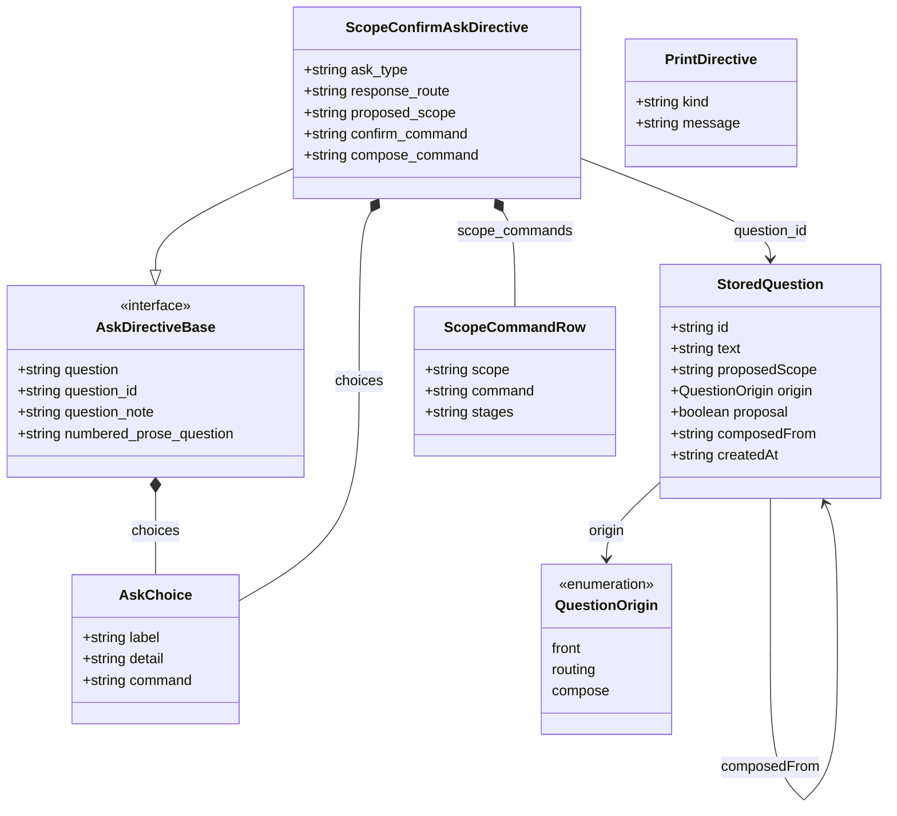
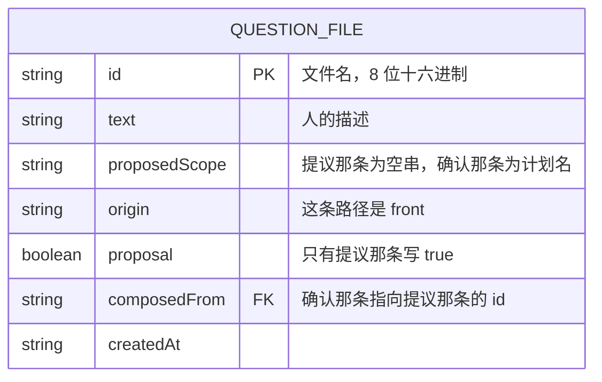

# aidlc 主路径上的类型关系

这份只描述不运行时的类型关系。

调用顺序在执行路径。

核对在每张图下。

这里只画这条计划问句会碰到的类型。标准库、只在一个函数里用一下的临时对象，以及暂不展开的问句种类，不画进来。`PrintDirective` 出现在图里，是因为第一次 `next` 打出的就是它；它和问题文件之间没有类型字段相连。

## 类图

- `StoredQuestion` 引用 `QuestionOrigin`，字段 `origin`。`core/tools/aidlc-question-store.ts` `QuestionOrigin`、`StoredQuestion` 【事实】
- `StoredQuestion` 引用另一条 `StoredQuestion`，字段 `composedFrom` 保存那条的 `id`。`saveQuestion` 把传入的上一条收成根编号再写入。`core/tools/aidlc-question-store.ts` `saveQuestion` 【事实】
- `ScopeConfirmAskDirective` 实现 `AskDirectiveBase`。基类没有 `export`，子类有。`core/tools/aidlc-directive.ts` `AskDirectiveBase`、`ScopeConfirmAskDirective` 【事实】
- `AskDirectiveBase` 包含 `AskChoice`，字段 `choices` 可选。`core/tools/aidlc-directive.ts` `AskDirectiveBase`、`AskChoice` 【事实】
- `ScopeConfirmAskDirective` 包含 `AskChoice`，字段 `choices` 在这条问句上是必填的三个选项。`core/tools/aidlc-directive.ts` `ScopeConfirmAskDirective` 【事实】
- `ScopeConfirmAskDirective` 包含 `ScopeCommandRow`，字段 `scope_commands`。`core/tools/aidlc-directive.ts` `ScopeCommandRow`、`ScopeConfirmAskDirective` 【事实】
- `ScopeConfirmAskDirective` 引用 `StoredQuestion`，字段 `question_id` 的类型是 `string`，值是刚存下的那条 `id`。`core/tools/aidlc-orchestrate.ts` `scopeConfirmAskDirective` 【事实】
- `PrintDirective` 的 `message` 是字符串。提议步骤把问题编号写进这段话，类型上没有指向 `StoredQuestion` 的字段。`core/tools/aidlc-directive.ts` `PrintDirective`；`core/tools/aidlc-orchestrate.ts` `printDirective`、`planProposalDirective` 【事实】
- 这条路径只用 `QuestionOrigin` 的 `front`。`routing` 和 `compose` 是同一个枚举里的另两个值，图上留着是因为类型就是这样声明的，对应分支这次不走。`core/tools/aidlc-question-store.ts` `QuestionOrigin` 【事实】

> 还不能确定：第一次 `next` 写入的 `text`，会不会被 `takePersonsOwnLine` 先改过用字。条件在指南文末的未知项里，这次没有会话记录。

## 实体图

主路径会把 `StoredQuestion` 存成项目里的 JSON 文件。类图里的 `StoredQuestion` 仍是内存里的那份类型。下面这张图只画文件里的形态，一条文件对应一个 `StoredQuestion`。

文件在 `aidlc/.aidlc-sessions/questions/<id>.json`。`<id>` 是 8 位十六进制，也是 `StoredQuestion.id`。

- `QUESTION_FILE` 是 `StoredQuestion` 的存储形态。`saveQuestion` 用 `JSON.stringify` 写入 `questions/<id>.json`，一行一条。`core/tools/aidlc-question-store.ts` `saveQuestion`、`questionRel` 【事实】
- 目录是 `workspaceRoot` 下的 `.aidlc-sessions`，`workspaceRoot` 是项目里的 `aidlc`。`core/tools/aidlc-locks.ts` `workspaceRoot`；`core/tools/aidlc-record-core.ts` `sessionsDir` 【事实】
- 技能写的是同一目录：`aidlc/.aidlc-sessions/questions/`。`harness/cursor/skills/aidlc/SKILL.md` Question transport 【事实】
- 这条路径上有两条文件。第一条由 `planProposalDirective` 写入：`proposedScope` 为空串，`origin` 为 `front`，`proposal` 为真。第二条由 `scopeConfirmAskDirective` 写入：`proposedScope` 为所提议的计划，`composedFrom` 指向第一条的 `id`，不传 `proposal`。`core/tools/aidlc-orchestrate.ts` `planProposalDirective`、`scopeConfirmAskDirective` 【事实】
- `id` 是主键，也是文件名。`composedFrom` 可空；第一条没有它，第二条有。`core/tools/aidlc-question-store.ts` `StoredQuestion`、`saveQuestion` 【事实】

> 还不能确定：打包进 Cursor 之后，会话目录是否仍是源码里的这个相对路径。技能正文仍写着这个目录；安装树这次没有打开。
