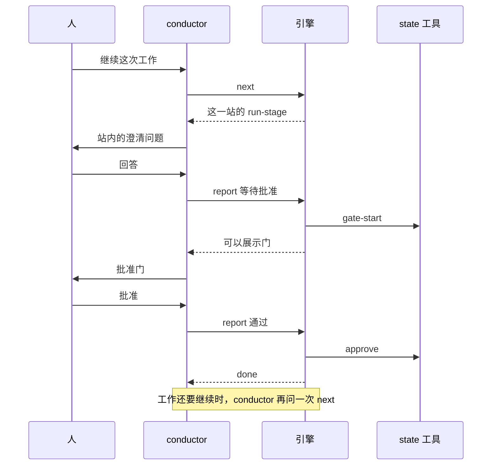

这份用一条示例走完字段变化：工作记录里当前站已是 `intent-capture`、复选框仍在途，conductor 做完这一站，再两次把结果交回。

示例命令是源码 skill 里的三次调用：`{{INVOKE}} engine orchestrate next`（人的原话原样跟在后面；本示例继续工作时没有额外参数），站做完后 `{{INVOKE}} engine orchestrate report --stage intent-capture --result awaiting-approval`，人批准后再 `{{INVOKE}} engine orchestrate report --stage intent-capture --result approved --user-input "Approve"`。安装后 `{{INVOKE}} 换成什么，这次没有核对。

设计原因在实现点。行号在每步和每个实现点的核对块。术语的白话在指南的概念卡片，这里不另写一遍。

## 示例约定

这条路径没有一份测试夹具把当前站设成 `intent-capture`。下面的工作记录按笔记里的符号写成最小示例，核对块标【推断】。

最接近的真实命令在 `t114` 的测试 13：poc 范围下执行 `next --stage intent-capture`，断言输出含 `"gate":true`。那是一次点名跳跃。本示例的入口是当前站已经在途，不用那条跳跃当入口。`t114` 里「在途当前站变成 `run-stage`」的夹具，当前站是 `feasibility`。

本示例假定工作记录里已经有：

- **Scope** 为 `poc`。这一站的 scopes 含 enterprise、feature、mvp、poc。
- **Current Stage** 为 `intent-capture`。
- 复选框为 in-progress。站正文还要执行。`t114` 把另一站的在途行写成 `[-]`，那个写法套到这一站是推断。

人这次只是继续工作。第一次 `next` 没有额外参数。skill 要求把人的原话原样交给第一次 `next`。

站做完后的两次报告，命令形状来自 Cursor skill 的完成序列，见上面第二行。`t115` 里真实跑过的批准输入是另一站：`report --result approved --user-input "looks good"`，站名是 `feasibility`，返回里有 `"kind":"done"`，并且工作还要继续。本示例只借用这个返回形状。

> 推断：没有测试把 Current Stage 播种成 `intent-capture` 且复选框为 in-progress。依据是 Branch 10 用 Current Stage 和复选框判定在途，本路径把站固定为 `intent-capture`，并且索引写的是站正文还要执行的那一轮。
> `core/tools/aidlc-orchestrate.ts:14209-14221` `getField` 【事实】
> `core/tools/aidlc-orchestrate.ts:14272-14282` `currentIsInFlight` 【事实】

> 核对：测试 13 的真实参数是 `--stage intent-capture`，环境范围 `poc`，断言 `gate` 为 true。在途夹具的当前站是 `feasibility`。
> `tests/unit/t114-orchestrate-next.test.ts:172-182` 【事实】
> `tests/unit/t114-orchestrate-next.test.ts:874-883` 【事实】

> 核对：完成序列的两次 `result`，以及 t115 的真实 `user-input` 和 `done`。
> `harness/cursor/skills/aidlc/SKILL.md:46` 【事实】
> `harness/cursor/skills/aidlc/SKILL.md:114-115` 【事实】
> `tests/unit/t115.test.ts:793-801` 【事实】

## 谁把工作交给谁

图上只画交接，不画字段。

人把原话交给 conductor。conductor 向引擎要下一步，做引擎点名的这一站，再把等待批准和通过交回。引擎读工作记录和编译好的阶段图，把转移派给 state 工具。state 工具负责门能不能打开、批准能不能落账。

## 逐步卡片

索引的一行对应一张卡片。标题与指南「主路径索引」相同。

### 向引擎要下一步

- 这一步之后：人的这次请求变成一次 `next`。这条命令读工作记录，不把生命周期转移写进去。
- 输入与输出：人继续这次工作的原话 → `engine orchestrate next`（本示例没有额外参数）
- 变化的字段：请求从一句人话变成 `next` 的参数。工作记录里的 Current Stage、复选框、Scope 没有被改写。
- 源码：`harness/cursor/skills/aidlc/SKILL.md` 转发循环；`core/tools/aidlc.ts` `engine-orchestrate`；`core/tools/aidlc-orchestrate.ts` `main`、`handleNext`

> 核对：转发循环先跑 `next`，阶段做完才 `report`。`engine orchestrate` 的 `next` 和 `report` 派到编排工具。`main` 在子命令 `next` 时调用 `handleNext`，`handleNext` 只调用 `routeNext`。
> `harness/cursor/skills/aidlc/SKILL.md:33-44` 【事实】
> `core/tools/aidlc.ts:1122-1128` `engine-orchestrate` 【事实】
> `core/tools/aidlc-orchestrate.ts:24209-24210` `main` 【事实】
> `core/tools/aidlc-orchestrate.ts:11349-11357` `handleNext` 【事实】

> 核对：普通 `next` 读工作记录和编译图，不执行站正文，也不改 Plan Approval。显式改设置、以及人要求的阶段或阶段跳跃，不在本示例里。
> `core/tools/aidlc-orchestrate.ts:10-16` 【事实】
> `tests/unit/t114-orchestrate-next.test.ts:7-10` 【事实】

### 认定当前站仍在途

- 这一步之后：工作记录里的 `intent-capture` 被认定还没做完，引擎不再去找下一站。
- 输入与输出：Current Stage 为 `intent-capture`、复选框为 in-progress → 派生判定「仍在途」
- 变化的字段：没有新的落盘字段。派生结果是当前站仍在途，因此这一轮不去找下一站。Current Stage 仍是 `intent-capture`，复选框仍是 in-progress。
- 源码：`core/tools/aidlc-orchestrate.ts` Branch 10、`currentIsInFlight`

> 核对：有 Current Stage 时读复选框。`pending`、`in-progress`、`awaiting-approval`、`revising`，或没有这一行，都算仍在途。本示例取 `in-progress`，因为索引写的是站正文还要执行的那一轮。
> `core/tools/aidlc-orchestrate.ts:14209-14221` `getField`、`parseCheckboxes` 【事实】
> `core/tools/aidlc-orchestrate.ts:14272-14282` `currentIsInFlight` 【事实】
> `core/tools/aidlc-orchestrate.ts:14313` 【事实】

> 核对：当前站已经做完时，才用 `nextInScopeStage` 找下一站。本示例在那之前返回。
> `core/tools/aidlc-orchestrate.ts:14442-14448` `nextInScopeStage` 【事实】

> 推断：`t114` 把在途复选框写成 `[-]`，那一行的站是 `feasibility`。本示例只借用「在途」这个状态名。

### 交出这一站的 run-stage

- 这一步之后：当前站变成一条通过合同检查的 directive。`kind` 为 `run-stage`，`stage` 为 `intent-capture`，`gate` 为 true。
- 输入与输出：仍在途的 `intent-capture` → 一条 `run-stage`
- 变化的字段：新出现 `kind`、`stage`、`gate`。同一次赋值还从节点抄来 `phase`（ideation）、`lead_agent`、`mode`（inline）和 `produces`（三份产物名）。要读的文件路径归下一步。
- 源码：`core/tools/aidlc-orchestrate.ts` `emitForSlug`、`emitRunStageForSlug`、`buildRunStageDirective`、`computeGate`；`core/tools/aidlc-directive.ts` `RunStageDirective`

> 核对：非 per-unit 站从 `emitForSlug` 走到 `emitRunStageForSlug`，再按 slug 取编译节点。`intent-capture` 的 phase 是 ideation，`mode` 是 inline，`execution` 是 ALWAYS。
> `core/tools/aidlc-orchestrate.ts:14436-14438` `emitForSlug` 【事实】
> `core/tools/aidlc-orchestrate.ts:18786-18794` `emitForSlug` 【事实】
> `core/tools/aidlc-orchestrate.ts:18835` `emitRunStageForSlug` 【事实】
> `core/tools/aidlc-orchestrate.ts:15125-15141` `emitRunStageForSlug` 【事实】
> `core/tools/aidlc-orchestrate.ts:11263-11264` `nodeForSlug` 【事实】
> `core/aidlc-common/stages/ideation/intent-capture.md:2-10` 【事实】

> 核对：`buildRunStageDirective` 写入 `kind`、`stage`、`phase`、`lead_agent`、`mode`、`gate`、`produces`。`computeGate` 对 initialization 返回 false；这一站不是 initialization，也不是 construction 里的骨架门，所以返回 true。发出前 `prepareEmission` 用 `validateDirective` 检查，不合格就拒绝发出。
> `core/tools/aidlc-orchestrate.ts:10196-10217` `buildRunStageDirective` 【事实】
> `core/tools/aidlc-orchestrate.ts:9946-9960` `computeGate` 【事实】
> `core/tools/aidlc-orchestrate.ts:9455-9458` `isSkeletonGateStage` 【事实】
> `core/tools/aidlc-orchestrate.ts:1863` `prepareEmission` 【事实】
> `core/tools/aidlc-orchestrate.ts:2121-2126` `validateDirective` 【事实】
> `core/tools/aidlc-directive.ts:270` `RunStageDirective` 【事实】
> `core/tools/aidlc-directive.ts:325` `gate` 【事实】
> `core/tools/aidlc-directive.ts:1959` `validateDirective` 【事实】

> 核对：笔记把发出前的合同检查记在 `2371`。那一行是旧计划批准选项的另一次检查。这条路径发出时走的是 `prepareEmission` 里的 `2121`。
> `core/tools/aidlc-orchestrate.ts:2371` 【事实】

### 附上要读的正文

- 这一步之后：这条 directive 带上阶段文件路径。工作流的第一份 `run-stage`，或这个聊天还没有 persona 时，再带上 conductor 的执行要求。
- 输入与输出：上一步那条 `run-stage` → 同一条 directive，多了要读的文件
- 变化的字段：`stage_file` 指向 ideation 下的 `intent-capture` 正文。条件成立时多一个 `conductor_persona`，内容是 conductor 的执行要求。`kind`、`stage`、`gate` 不变。
- 源码：`core/tools/aidlc-orchestrate.ts` `stageFileFor`、`readConductorPersona`；`core/aidlc-common/conductor.md`

> 核对：`stage_file` 由 phase 和 slug 拼出，和 `kind`、`gate` 在同一次赋值里写上。索引把「这是哪一站」和「要读哪份正文」分成两步；发出前它们已经在同一条 directive 里，不是两次 `next`。
> `core/tools/aidlc-orchestrate.ts:9077-9078` `stageFileFor` 【事实】
> `core/tools/aidlc-orchestrate.ts:10230` `stage_file` 【事实】

> 核对：工作流的第一份 `run-stage`，或这个聊天还需要 persona 时，把 `conductor.md` 放进 `conductor_persona`。conductor 正文写明引擎决定下一站，生命周期只走 `report`。
> `core/tools/aidlc-orchestrate.ts:9094-9101` `readConductorPersona` 【事实】
> `core/tools/aidlc-orchestrate.ts:10389-10412` 【事实】
> `core/aidlc-common/conductor.md:6-12` 【事实】
> `core/aidlc-common/conductor.md:34-35` 【事实】

> 推断：本示例没有一份活的工作记录，不能确定这次 `next` 是不是工作流的第一份 `run-stage`。字段规则以上面的条件为准。persona 注释里的 `.claude/...` 路径，和 `readConductorPersona` 实际解析的路径不是同一句。
> `core/tools/aidlc-orchestrate.ts:9081-9095` 【事实】

### 按站正文澄清意图

- 这一步之后：人的意图变成这一站的澄清问题，以及三份产物：意图说明、干系人图、这一站的提问记录。
- 输入与输出：带 `stage_file` 的 `run-stage`，加上人的回答 → `intent-capture-questions.md`、`intent-statement.md`、`stakeholder-map.md`
- 变化的字段：提问记录里出现问题，`[Answer]` 先空着，人答完后写上选择。意图说明和干系人图写到这一站的记录目录。工作记录的复选框还不变成通过。
- 源码：`core/aidlc-common/stages/ideation/intent-capture.md` Step 2 到 Step 5；`harness/cursor/skills/aidlc/question-rendering.md`

> 核对：三份产物名在 frontmatter。提问记录在 Step 2 创建，意图说明和干系人图在 Step 4 创建，路径都在 `<record>/ideation/intent-capture/` 下。Step 3 收齐回答，Step 5 处理假定。给人看的问题按 Cursor 附录渲染成编号散文。
> `core/aidlc-common/stages/ideation/intent-capture.md:16-19` 【事实】
> `core/aidlc-common/stages/ideation/intent-capture.md:101-103` 【事实】
> `core/aidlc-common/stages/ideation/intent-capture.md:151-158` 【事实】
> `core/aidlc-common/stages/ideation/intent-capture.md:182-190` 【事实】
> `core/aidlc-common/stages/ideation/intent-capture.md:200-205` 【事实】
> `harness/cursor/skills/aidlc/question-rendering.md:1-17` 【事实】
> `harness/cursor/skills/aidlc/SKILL.md:88` 【事实】

> 核对：`directive.produces` 在上一步的同一次赋值里已经放上解析后的路径。站正文给出的是记录目录下的文件名。这次没有对一份活记录打印过解析后的字符串。
> `core/tools/aidlc-orchestrate.ts:10211-10217` 【事实】
> `core/tools/aidlc-directive.ts:265-269` 【事实】

> 还不能确定：frontmatter 写了 `summary_confirmation: required`，也写了 reviewer。完成序列在 directive 列出 `reviewer` 时会加载审阅协议。`ceremony` 上的开关由 `summaryConfirmationOwed` 计算，这次没有读那个函数体，不把开关写成已核实的值。审阅协议正文不在这条路径里。
> `core/aidlc-common/stages/ideation/intent-capture.md:11-15` 【事实】
> `core/tools/aidlc-orchestrate.ts:10189-10191` `summaryConfirmationOwed` 【事实】
> `harness/cursor/skills/aidlc/SKILL.md:110-111` 【事实】

### 打开批准门

- 这一步之后：站的完成变成「等待批准」。引擎交回下一站的显示名和产物位置，人看到通过或要求修改。
- 输入与输出：三份产物已写好 → `report --stage intent-capture --result awaiting-approval` → 给人看的门
- 变化的字段：复选框变成 awaiting-approval。交回的是一条 `print`，上面多了 `next_stage`（下一站的显示名，没有下一站则为空）和产物位置。人看到的选择是 Approve 和 Request Changes。
- 源码：`harness/cursor/skills/aidlc/SKILL.md` 完成序列；`core/tools/aidlc-orchestrate.ts` `handleReport`；`core/tools/aidlc-lib.ts` `nextInScopeStage`

> 核对：`gate` 为 true 的完成序列先 `report --result awaiting-approval`，再向人展示门，并停住等本人选择。批准不走问题日志。这一站 Step 7 使用协议里的批准门，选择是 Approve 和 Request Changes。
> `harness/cursor/skills/aidlc/SKILL.md:104-115` 【事实】
> `core/aidlc-common/stages/ideation/intent-capture.md:229-240` 【事实】
> `core/aidlc-common/protocols/stage-protocol.md:189-191` 【事实】
> `harness/cursor/skills/aidlc/question-rendering.md:30-32` 【事实】

> 核对：非 initialization 即要过门。复选框为 in-progress 时，`awaiting-approval` 派发 `gate-start`。成功后的 `print` 带上 `next_stage`（`nextInScopeStage` 的显示名，没有则为空）和产物那一行。
> `core/tools/aidlc-orchestrate.ts:22438` `isGated` 【事实】
> `core/tools/aidlc-orchestrate.ts:22810-22831` `gate-start` 【事实】
> `core/tools/aidlc-orchestrate.ts:22944-22950` `next_stage` 【事实】
> `core/tools/aidlc-orchestrate.ts:22953-22971` 【事实】
> `core/tools/aidlc-lib.ts:38144-38148` `nextInScopeStage` 【事实】

> 推断：本示例不写下一站的显示名。`next_stage` 来自当时的计划和范围，这次没有对一份活记录算过。

### 把批准写回工作记录

- 这一步之后：人的批准变成工作记录里的通过。引擎交回 `done`。工作还要继续时，conductor 再问一次 `next`；下一站的正文不在这条路径里。
- 输入与输出：人选择 Approve → `report --stage intent-capture --result approved --user-input "Approve"` → `kind` 为 `done`
- 变化的字段：工作记录里这一站记为通过。返回的 `kind` 变成 `done`。工作还没结束时带上 `workflow_continues`。下一站要等再一次 `next` 才出现。
- 源码：`core/tools/aidlc-orchestrate.ts` `spawnState`；`core/tools/aidlc-state.ts` `handleApprove`

> 核对：过门的站在复选框已是 awaiting-approval 时，`approved` 交给 `approve`。`spawnState` 拉起 state 子进程。`handleApprove` 没有 export；非团队门要先通过 `validateSlugInState(..., "awaiting-approval")`。成功后发出 `kind` 为 `done`。Status 还不是 Completed 时带 `workflow_continues`。`done` 且 `workflow_continues` 为 true 时，conductor 立刻再跑一次不带参数的 `next`。
> `core/tools/aidlc-orchestrate.ts:23116-23143` 【事实】
> `core/tools/aidlc-orchestrate.ts:20298-20311` `spawnState` 【事实】
> `core/tools/aidlc-state.ts:1136-1137` 【事实】
> `core/tools/aidlc-state.ts:8265` `handleApprove` 【事实】
> `core/tools/aidlc-state.ts:8284-8285` `validateSlugInState` 【事实】
> `core/tools/aidlc-orchestrate.ts:22004-22008` `workflowContinues` 【事实】
> `core/tools/aidlc-orchestrate.ts:23336-23343` `done` 【事实】
> `harness/cursor/skills/aidlc/SKILL.md:41` 【事实】
> `harness/cursor/skills/aidlc/SKILL.md:84` 【事实】

> 核对：`t115` 在 `feasibility` 上看到 `"kind":"done"`，并且工作继续。那次测试自己先做了 `gate-start`，再 `report --result approved --user-input "looks good"`。审计顺序是 `GATE_APPROVED`、`STAGE_COMPLETED`、`STAGE_STARTED` 各一轮。本示例的站和 `user-input` 用的是 skill 对这一站的写法。
> `tests/unit/t115.test.ts:770-806` 【事实】

## 分支

同一条入口上、会在这一轮提前离开的出口。复选框已经是等待批准时的再入，不另起阶段名。

| 如果 | 停在哪 | 有没有回合结束事件 |
|---|---|---|
| 工作记录没有 Current Stage | `error`，循环停止 | 有 |
| 复选框已是 awaiting-approval，并且不是还欠着要先做的 Unit 步 | 带 `gate_only` 的 `run-stage`，只展示已经打开的门 | 有 |
| 已批计划里这一站是 SKIP，光标仍停在它上面 | `print`，让人改走 `report --result skipped` | 无 |
| 站自己的条件证明这一站不适用 | `report --result skipped`，然后重新 `next` | 无 |
| 人在门上要求修改 | `report --result rejected`，进入修订 | 无 |
| 复选框仍是 in-progress 就直接报告通过 | 先补一次 `gate-start`，再 `approve` | 无 |
| 通过之后的 `done` 带 `workflow_continues` | 不结束整次工作，立刻再跑一次 `next` | 无 |

> 核对：没有 Current Stage 时发出 `error`。`error` 让 conductor 停住。
> `core/tools/aidlc-orchestrate.ts:14212-14217` 【事实】
> `harness/cursor/skills/aidlc/SKILL.md:83` 【事实】

> 核对：复选框已是 awaiting-approval 时，Branch 10 在 `emitForSlug` 之前返回。先做成 `run-stage`，再由 `applyGateOnlyShape` 标上 `gate_only`，并保持 `gate` 为 true。协议要求此时只展示门，不重跑站正文。
> `core/tools/aidlc-orchestrate.ts:14320-14321` 【事实】
> `core/tools/aidlc-orchestrate.ts:14353-14356` `buildRunStageDirective` 【事实】
> `core/tools/aidlc-orchestrate.ts:14385` `applyGateOnlyShape` 【事实】
> `core/tools/aidlc-orchestrate.ts:14600-14608` `gate_only` 【事实】
> `core/aidlc-common/protocols/stage-protocol.md:203-204` 【事实】
> `core/tools/aidlc-directive.ts:483-486` 【事实】

> 核对：计划后缀为 SKIP 时，在途光标不发 `run-stage`，`print` 里写明改走 `report --result skipped`。站条件不适用时，skill 同样要求 `skipped` 后再 `next`。
> `core/tools/aidlc-orchestrate.ts:14291-14310` 【事实】
> `harness/cursor/skills/aidlc/SKILL.md:109` 【事实】

> 核对：要求修改走 `rejected`。复选框仍是 in-progress 就报告 `approved` 时，先放入 `gate-start`（带 `--recovered`），再放入 `approve`。`done` 且 `workflow_continues` 为 true 时马上再 `next`。
> `harness/cursor/skills/aidlc/SKILL.md:115` 【事实】
> `core/tools/aidlc-orchestrate.ts:23116-23143` 【事实】
> `harness/cursor/skills/aidlc/SKILL.md:41` 【事实】
> `harness/cursor/skills/aidlc/SKILL.md:84` 【事实】

## 实现点

每点只讲为什么这样，不把上一节的步骤再走一遍。验证问题的答案不在本文件。

### 下一站由记录和编译图决定

给人看的阶段表把 `intent-capture` 排在初始化之后，conductor 读得懂这张表。若由 conductor 看着表决定下一站，对话里就会有第二套路线。

引擎每次只交出一条 directive。当前站从工作记录读出，节点从编译后的 `stage-graph.json` 读出。阶段表自己声明它不是派发逻辑。

替代做法是让 conductor 按阶段表散文往下数。代价是路线有两个主人：表和编译图一旦不一致，人看到的顺序和实际交出的站会分叉。`classic` 不在这一站的 scopes 里，凭表的「常见顺序」往下走，会把 classic 计划也送进这一站。

常见误区是把阶段表当成路由器。表是给人看的镜像。

验证：conductor 若只读阶段表、不再调用 `next`，classic 计划有没有可能被送进 `intent-capture`？依据是哪一处 scopes，哪一句表的声明？

> 核对：skill 把站与站之间的路线交给 orchestrate。阶段表声明自己不是派发。编译图由 `loadGraph` 读取。scopes 没有 classic。
> `harness/cursor/skills/aidlc/SKILL.md:25` 【事实】
> `harness/cursor/skills/aidlc/tables.md:3` 【事实】
> `core/tools/aidlc-graph.ts:1401-1407` `loadGraph` 【事实】
> `core/aidlc-common/stages/ideation/intent-capture.md:26-30` 【事实】

### 门按阶段算，不按 ALWAYS 算

`intent-capture` 的 `execution` 是 ALWAYS。若有人把 ALWAYS 理解成「不用等人」，这一站就会自己往下走。

`computeGate` 看的是阶段，不是 `execution`。initialization 返回 false。construction 里尚未表态的骨架门可以是 `unresolved`。其余要执行的站返回 true。这一站的 phase 是 ideation，所以是 true。协议写明，除初始化三站外，每一站都要人明确批准。

替代做法是 `execution` 为 ALWAYS 就设 `gate: false`。代价是这一站不再向人要批准，和协议相反。`t114` 测试 13 专门盯住这件事：ALWAYS 的 `intent-capture` 必须是 `gate: true`。

常见误区是用 `execution` 判断要不要等人。ALWAYS 回答的是「这一站在不在计划里」，不是「做完要不要停」。

验证：若有人把 `computeGate` 改成「`execution` 不是 ALWAYS 才过门」，测试 13 的断言会期待什么，实际会得到什么？

> 核对：
> `core/tools/aidlc-orchestrate.ts:9934-9960` `computeGate` 【事实】
> `core/aidlc-common/protocols/stage-protocol.md:191` 【事实】
> `core/aidlc-common/stages/ideation/intent-capture.md:2-5` 【事实】
> `tests/unit/t114-orchestrate-next.test.ts:874-883` 【事实】

### 人看到的门来自等待批准之后的 print

合同里的种类仍包括 `present-gate`。开发者参考也把它写进「会对人开口」的一列。顺着种类名看，会以为门是引擎直接交出来的一种 directive。

这条成功路径上，`routeNext` 交出的是 `run-stage`。人看到的选择，是 conductor 在报告「等待批准」之后，按协议讲出来的。`next_stage` 和产物位置要等 `gate-start` 回来才写上 `print`。决策注释写本处理器不发出 `present-gate`；注释不能单独当行为依据，发出的 `kind` 才是依据。

替代做法是站做完时由引擎发出 `present-gate`。代价是下一站的显示名和产物位置那时还没有：它们是 `report` 写完门之后才有的。提前发一种「门」directive，要么再发明下一站，要么等第二次往返，门的内容仍从 `report` 来。

常见误区是看见对话里的批准选择题，就认为上一条引擎输出的 `kind` 是 `present-gate`。

验证：在本示例里，人第一次看见 Approve / Request Changes 之前，引擎刚刚交回的 `kind` 是什么？`next_stage` 是在哪一次调用之后才出现的？

> 核对：`DirectiveKind` 含 `present-gate`。参考文档把它列进会对人开口的 directive。这条路径发出 `run-stage`，门在等待批准的 `print` 上。
> `core/tools/aidlc-directive.ts:104-115` `DirectiveKind` 【事实】
> `docs/reference/03-orchestrator.md:512-515` 【事实】
> `core/tools/aidlc-orchestrate.ts:8904-8909` 【事实】
> `core/tools/aidlc-orchestrate.ts:10196-10208` 【事实】
> `core/tools/aidlc-orchestrate.ts:22944-22950` 【事实】

### 转移只在 state 工具里落账

conductor 若直接改复选框，或引擎在 `report` 里自己重写转移，批准规则就会有两份。

`report` 按门的状态拼出 state 子命令，用 `spawnState` 拉起子进程，自己不重写转移。`approve` 进入 `handleApprove`。这个函数没有 export。非团队门先要求复选框已是 awaiting-approval，所以「先开门，再通过」只有这一道检查。旁边的注释写 `aidlc-state.ts` 什么都不 export，导入 `handle*` 会构建失败。同文件其实 import 了别的函数，那句注释不成立。`handleApprove` 本身仍然没有 export，转移子命令仍走 spawn。

替代做法是 export `handleApprove`，让 `report` 在进程内调用。代价是注释里的「构建失败」已经和 import 事实不符；真要避免的是两套转移。子进程自己持有锁，引擎再包一层锁盖不住那个子进程。

常见误区是按「什么都不 export」去找一个进程内的批准函数，或者让 conductor 直接调用 `aidlc-state.ts` 的生命周期动词。skill 禁止后一种。

验证：若 conductor 在复选框还是 in-progress 时直接调用 state 的 `approve`，`validateSlugInState` 会要求哪一种复选框状态？`report` 在同样状态下会先派发哪一条子命令？

> 核对：
> `core/tools/aidlc-orchestrate.ts:19959-19966` 【事实】
> `core/tools/aidlc-orchestrate.ts:20298-20311` `spawnState` 【事实】
> `core/tools/aidlc-state.ts:8265` `handleApprove` 【事实】
> `core/tools/aidlc-state.ts:8284-8285` `validateSlugInState` 【事实】
> `core/tools/aidlc-orchestrate.ts:23130-23143` 【事实】
> `harness/cursor/skills/aidlc/SKILL.md:115` 【事实】
> `core/aidlc-common/conductor.md:34-35` 【事实】

### 站内问题和批准门是两类记录

两者到了 Cursor 里都是编号选项，看起来像同一个问题。

协议把它们分开。不是门上的问题，先用日志记下再给人看。批准选择只走 `report`：先 `awaiting-approval`，人批准后再 `approved`，要求修改则是 `rejected`。skill 写明批准是生命周期报告，不要对这扇门调用问题日志。编号散文只负责 Cursor 上怎么画，批准门也走这份画法。

替代做法是把 Approve 也记成一条 decision，再补一次 `report`。代价是同一次选择有两条记录，以后分不清哪一条才算通过。门上若出现协议里没有报告方式的选项，选择会无处落账。`t-gate-choices-map-to-reports` 读的是协议和站正文，不是某一个人的原话。

常见误区是看见编号选项，就用问题日志把批准记下来，不再 `report`。

验证：Approve 应该出现在哪一条命令的 `--user-input` 里？同一条完成序列为什么禁止对这扇门调用 `aidlc-log.ts` 的 decision 或 answer？

> 核对：
> `core/aidlc-common/protocols/stage-protocol.md:180-183` 【事实】
> `harness/cursor/skills/aidlc/SKILL.md:114-115` 【事实】
> `harness/cursor/skills/aidlc/question-rendering.md:30-32` 【事实】
> `tests/unit/t-gate-choices-map-to-reports.test.ts:1-12` 【事实】

### 执行要求只在需要时放进 directive

conductor 的执行要求写在 `conductor.md`。skill 说不要自己按路径去读它，引擎会放进会话里的第一份 `run-stage`。

`buildRunStageDirective` 在返回前决定是否挂上 `conductor_persona`：工作流的第一份 `run-stage`，或者这个聊天还没有拿到这份正文。之后的 directive 省略这个字段，因为会话里已经有了。新的聊天或压缩掉上下文的聊天可以再带一次。

替代做法是每条 `run-stage` 都带上全文，或让 conductor 按注释里的 `.claude/...` 路径自己读。代价是每一步都重复一份长正文；注释里的路径也不是 `readConductorPersona` 实际用的解析。源码作者文件在 `core/aidlc-common/conductor.md`。

常见误区是每条 `run-stage` 都该有 `conductor_persona`，或者 skill 会按一个固定路径加载它。

验证：同一次工作的第二份 `run-stage`，在同一个聊天里，`conductor_persona` 按哪两个条件才会再次出现？

> 核对：
> `core/tools/aidlc-orchestrate.ts:10389-10412` 【事实】
> `core/tools/aidlc-orchestrate.ts:9081-9095` 【事实】
> `harness/cursor/skills/aidlc/SKILL.md:127-129` 【事实】
> `core/aidlc-common/conductor.md:9-12` 【事实】

## 异常、测试与风险

本次没有运行测试，也没有在 Cursor 里走一轮。下面「测试确认」指的是测试源码里写明的断言和夹具，不是这次执行的结果。

### 已由代码或测试确认的行为

`t114` 从进程边界进入 `main`，因为 `handleNext` 没有 export。文件头写明普通 `next` 读工作记录和编译图，stdout 上恰好一条 directive，并且不改工作记录。在途当前站的用例播种的是 `feasibility`，断言 `kind` 为 `run-stage`、`stage` 为 `feasibility`。测试 13 用 `next --stage intent-capture` 和范围 `poc`，断言 `gate` 为 true，并写明这个值和 `execution: ALWAYS` 不是一回事。

`t115` 覆盖 `report` 的前置和过门后的通过。没有 `--result` 时发出 `error`。`feasibility` 那一组先 `gate-start`（注释写明复选框从 `[-]` 到 `[?]`，以便 `validateSlugInState(awaiting-approval)` 通过），再 `report --result approved --user-input "looks good"`。断言包括 `"kind":"done"`、工作继续、审计事件顺序为 `GATE_APPROVED`、`STAGE_COMPLETED`、`STAGE_STARTED`，并且 `STAGE_STARTED` 只有一次。调用方是 skill 的完成序列。落账在 `handleApprove`，由 `spawnState` 拉起，不在编排文件里重写。

`t-gate-choices-map-to-reports` 读协议和已发布的站正文，检查门上的选项都有协议里的报告方式。它不跑命令行。

调用方还有 `core/tools/aidlc.ts` 的 `engine-orchestrate`，动词包含 `next` 和 `report`。

这条成功路径上要守住的不变量：

- 本示例这种不带跳跃、不改设置的 `next`，不写生命周期转移。
- `intent-capture` 的 `gate` 为 true。
- 非团队门的 `approve` 要求复选框已是 awaiting-approval。
- conductor 不直接调用 state 工具的生命周期动词。
- 通过之后若工作还没结束，`done` 带 `workflow_continues`，下一站由再一次 `next` 读新的工作记录决定。

修改后应回归：

- 改 `next` 怎样从在途的当前站交出 `run-stage`：回归 `tests/unit/t114-orchestrate-next.test.ts`。调用方是 Cursor skill 的转发循环，以及 `aidlc.ts` 把 `engine orchestrate next` 派到编排工具。
- 改 `report` 或批准落账：回归 `tests/unit/t115.test.ts`。调用方是 skill 的完成序列：先 `awaiting-approval`，人批准后再 `approved`。落账进入 `handleApprove`。
- 改门上给人的选项：回归 `tests/unit/t-gate-choices-map-to-reports.test.ts`。调用方是阶段协议的批准门，以及 `question-rendering.md`。
- 改完成顺序或审阅条件时，再读 `core/aidlc-common/protocols/stage-protocol-reviewer.md`。这一站的 frontmatter 写了 reviewer。审阅协议正文这次不展开。
- 改「人的原话怎样进 `next`」时，再读 `core/tools/aidlc-message-store.ts` 和 `core/tools/aidlc-reply-reader.ts`。那是参数里没有人的原话时的补救，不是这条成功路径。

> 核对：
> `tests/unit/t114-orchestrate-next.test.ts:1-19` 【事实】
> `tests/unit/t114-orchestrate-next.test.ts:172-182` 【事实】
> `tests/unit/t115.test.ts:1-14` 【事实】
> `tests/unit/t115.test.ts:263-264` 【事实】
> `tests/unit/t115.test.ts:770-806` 【事实】
> `tests/unit/t-gate-choices-map-to-reports.test.ts:1-12` 【事实】
> `core/tools/aidlc.ts:1122-1128` 【事实】
> `core/tools/aidlc-orchestrate.ts:11349-11357` `handleNext` 【事实】

### 尚未验证、值得检查的风险

本次没有运行上面三份测试，也没有对一份 Current Stage 为 `intent-capture` 的活工作记录执行 `next`。本示例的工作记录是推断。

安装进 Cursor 之后，`{{INVOKE}}` 被替换成的具体命令仍然未知。源码 skill 里仍是这个记号。

Branch 10 在 `emitForSlug` 之前还有恢复提问、项目类型提问、欠下的回跳、人员编制类提问和 swarm。本示例假定它们都不命中。改在途分支时，这些提前返回仍在同一函数里。

`t114` 文件头写 `next` 不改变工作记录。引擎文件头写普通路由是只读的，但显式 `next config set` 可以改设置，人要求的阶段跳跃会先执行再路由。测试头的「一律不改」比文件头窄。本示例的成功路径是不带这些参数的 `next`。

文件开头写 skill 还没调用这个文件、只被测试锻炼。后面的子命令表把 `next` 和 `report` 标成正在使用，Cursor skill 也在跑这两条命令。按文件头去判断「引擎还没接上」会改错地方。

> 核对：
> `core/tools/aidlc-orchestrate.ts:1-6` 【事实】
> `core/tools/aidlc-orchestrate.ts:10-16` 【事实】
> `core/tools/aidlc-orchestrate.ts:27-37` 【事实】
> `harness/cursor/skills/aidlc/SKILL.md:39-42` 【事实】
> `tests/unit/t114-orchestrate-next.test.ts:7-10` 【事实】

> 还不能确定：某个真实项目上，当前站是不是 `intent-capture`。安装后的命令前缀没有读 `dist/`。

### 不影响正确性、但可能有用的改进

把编排文件头里「skill 还没调用」和「什么都不 export」改成与正在使用的子命令表、以及实际 import 一致，后来的人就不会按过时注释绕开 `report`。

`t114` 可以加一条夹具：Current Stage 为 `intent-capture`、复选框为 in-progress、Scope 为 `poc`，断言 `run-stage` 且 `gate` 为 true。现在这一轮要靠 `feasibility` 的在途用例，加上测试 13 的跳跃用例，才能拼出本示例。
