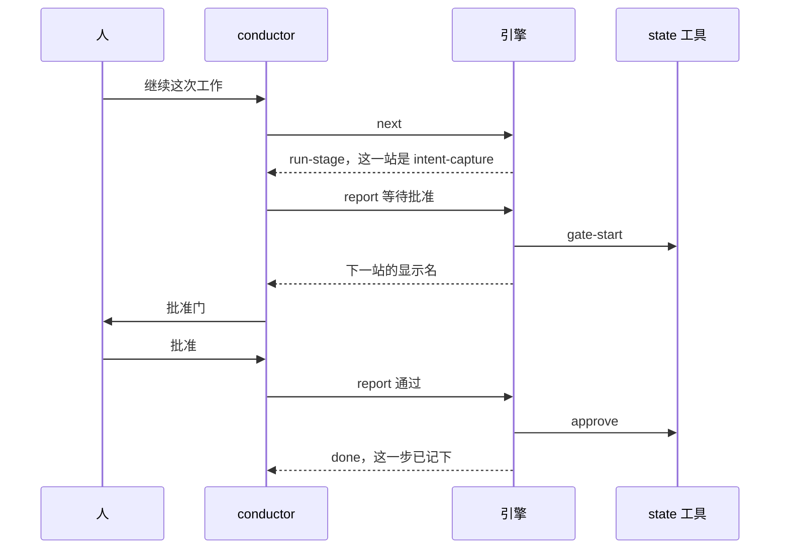

# 人驱动一次工作

## 打开顺序

先读本文件的八条结论，再按下面的阅读路线走。`survey-notes.md` 是证据索引，不是讲义。

这份只回答一件事：人在 Cursor 里驱动一次已经在进行的工作，并且当前站是 `intent-capture` 时，conductor 怎样向引擎要下一步、做完这一站、再把结果交回。示例是转发循环里的两次调用：`engine orchestrate next`，站做完后 `engine orchestrate report`。源码 skill 里命令前面的 `{{INVOKE}}` 仍是记号，安装后换成什么，见文末未知项。核对写在文末「核对与未知」；每张概念卡片自己的核对只服务那一张卡片。

关注点是职责和文件地图、这一条主路径、关键取舍、以及接下来要改代码时的回归点，四者都写在下面。设计原因的展开留给执行路径的实现点。本文件用结论和「最容易误用」标出要守住的边界。类型之间谁包含谁，见同目录的 `structure.md`，这里不把那张类图再画一遍。

## 八条结论

1. **要解决的问题。** 下一站由工作记录和编译好的阶段图决定，conductor 不在对话里重算。人在 `intent-capture` 里把意图说清楚，并在门上决定通过还是要求修改。
2. **负责到哪里。** 这条路径从 Cursor 的 conductor skill 开始，覆盖「问下一步、执行 `intent-capture`、把结果交回」。打包、插件、其他工具里的 skill、其他站的正文，都不在这次范围内。
3. **停住的接缝。** 这一站的 `gate` 是 true：站内工作做完，先向引擎报告等待批准，再把选择给人。人明确批准之后，才报告通过。初始化三站会自己往下走，那三站的正文不在这里。
4. **输入。** 工作记录里已经有 `Current Stage`，本路径把这一站固定为 `intent-capture`，复选框还没有完成。人的原话从第一次 `next` 的参数原样交进去。
5. **两类记录谁先谁后。** 站里普通问题的日志，和生命周期的报告，是两类记录。普通问题按协议先记再给人看。打开门用「等待批准」的报告，发生在给人看门之前。人的选择用其后的「通过」或「要求修改」报告。这条成功路径上，`next` 读进度并交出下一步，`report` 才把转移派给 state 工具。
6. **易误会：门从哪来。** 人看到的批准门，是 conductor 在 `run-stage` 做完、报告「等待批准」之后，按协议讲出来的选择。合同里的 `present-gate` 这一种指令，这条成功路径的 `routeNext` 不把它交出来。
7. **易误会：谁排下一站。** 给人看的阶段表不负责派发，引擎读编译后的阶段图。`intent-capture` 出现在 enterprise、feature、mvp、poc 这些计划里。classic 计划不会走到这一站。
8. **易误会：引擎还用不用。** 引擎文件开头有一句，说 skill 还没调用这个文件、只被测试锻炼。同一文件后面的子命令表把 `next` 和 `report` 标成正在使用，Cursor skill 也在跑这两条命令。以正在使用的那段和 skill 为准。

> 核对：结论 1–3 的分工见 skill 对路线所有权的声明，以及 conductor 正文里「生命周期只走 report」。
> `harness/cursor/skills/aidlc/SKILL.md:25` `harness/cursor/skills/aidlc/SKILL.md:33-44` 【事实】
> `core/aidlc-common/conductor.md:6-7` `core/aidlc-common/conductor.md:34-35` 【事实】
> `core/tools/aidlc-orchestrate.ts:9946-9960` `computeGate` 【事实】
> `core/aidlc-common/protocols/stage-protocol.md:191` 【事实】
>
> 核对：结论 4 的输入是 Branch 10 读到的当前站；人的原话由 skill 要求原样交给第一次 `next`。
> `core/tools/aidlc-orchestrate.ts:14209-14221` `getField` 【事实】
> `harness/cursor/skills/aidlc/SKILL.md:46` 【事实】
>
> 核对：结论 5 的先后。非门上的问题走日志；批准选择只走 `report`。等待批准的报告在复选框为 `in-progress` 时派发 `gate-start`，成功后的 print 带上 `next_stage`。其后的通过报告交给 `approve`。复选框仍是 `in-progress` 就直接报告通过时，会先补一次 `gate-start`。通过成功后交回 `done`。
> `core/aidlc-common/protocols/stage-protocol.md:180-183` 【事实】
> `harness/cursor/skills/aidlc/SKILL.md:114-115` 【事实】
> `core/tools/aidlc-orchestrate.ts:22810-22831` `gate-start` 【事实】
> `core/tools/aidlc-orchestrate.ts:22944-22950` `next_stage` 【事实】
> `core/tools/aidlc-orchestrate.ts:23116-23143` 【事实】
> `core/tools/aidlc-orchestrate.ts:23336-23348` `done` 【事实】
>
> 核对：结论 6。`DirectiveKind` 仍含 `present-gate`。开发者参考在「agent 会开口的 directive」那一列里也写了它。决策注释说本处理器不发出 `present-gate`；注释不能单独当行为依据。这条路径实际交出的是 `kind: "run-stage"`，门来自等待批准之后的 print。
> `core/tools/aidlc-directive.ts:104-115` 【事实】
> `docs/reference/03-orchestrator.md:512-515` 【事实】
> `core/tools/aidlc-orchestrate.ts:8904-8909` 【事实】
> `core/tools/aidlc-orchestrate.ts:10196-10208` 【事实】
> `core/tools/aidlc-orchestrate.ts:22922-22950` 【事实】
>
> 核对：结论 7。阶段表声明自己不是派发逻辑。`scopes` 没有 classic。
> `harness/cursor/skills/aidlc/tables.md:3` 【事实】
> `core/aidlc-common/stages/ideation/intent-capture.md:26-30` 【事实】
> `core/tools/aidlc-graph.ts:1401-1407` `loadGraph` 【事实】
>
> 核对：结论 8。文件头与 LIVE 子命令表并列，skill 已在调用。
> `core/tools/aidlc-orchestrate.ts:1-6` 【事实】
> `core/tools/aidlc-orchestrate.ts:27-37` 【事实】
> `harness/cursor/skills/aidlc/SKILL.md:39-42` 【事实】

## 分阶段阅读路线

半天用来走完指南、执行路径和练习。下面五段只覆盖本指南。执行路径和练习还没写。时间不够时，跳过第 5 段。

### 1. 建立整体认知

- 阅读位置：本文件「八条结论」和「运行时协作」。
- 要回答的问题：这一轮里，人、conductor、引擎、state 工具各做什么？哪一步会停下来等人？
- 预计耗时：20 分钟。
- 验收：能用自己的话讲清，下一站由记录和阶段图决定，`intent-capture` 做完要等人批准。

### 2. 读关键接口

- 阅读位置：下面六个符号。`routeNext`、`buildRunStageDirective`、`computeGate`、`handleReport` 在 `core/tools/aidlc-orchestrate.ts`。`RunStageDirective` 在 `core/tools/aidlc-directive.ts`。`handleApprove` 在 `core/tools/aidlc-state.ts`。
- 要回答的问题：`next` 怎样变成一条 `run-stage`？`gate` 为什么在这一站是 true？`report` 把通过交给谁落账？
- 预计耗时：45 分钟。
- 验收：能指出这六个符号各自的输入和输出，且没有再去读暂不展开的站正文。

### 3. 追踪一条真实路径

- 阅读位置：本文件「主路径索引」。字段怎么变、设计原因和替代方案在执行路径的逐步卡片和实现点。那份文件还没写，这一段先把索引里的对象变化讲顺。
- 要回答的问题：走完索引的每一阶段之后，业务对象变成了什么？
- 预计耗时：40 分钟。
- 验收：能按索引的阶段名讲完这一轮，并且不另起一套阶段名。

### 4. 读测试并准备修改

- 阅读位置：本段的回归点和调用方。修改题不在本文件，练习还没出。
- 要回答的问题：改 `next`、改 `report` 或批准落账、改门上的选项，各自要回归哪份测试，调用方在哪？
- 预计耗时：40 分钟。
- 验收：能说出下面三组回归点，并且知道 `handleApprove` 没有 export，转移由 `report` 拉起 state 子进程。

回归时看这些测试和调用方。本次没有运行它们。

- 改 `next` 怎样从在途的当前站交出 `run-stage`：回归 `tests/unit/t114-orchestrate-next.test.ts`。调用方是 Cursor skill 的转发循环，以及 `core/tools/aidlc.ts` 里把 `engine orchestrate` 的 `next` 派到 `aidlc-orchestrate.ts`。`handleNext` 只调用 `routeNext`，测试从进程边界进 `main`。
- 改 `report` 或批准落账：回归 `tests/unit/t115.test.ts`。调用方仍是 skill 的完成序列：先 `report --result awaiting-approval`，人批准后再 `report --result approved`。落账在 `aidlc-state.ts` 的 `approve` 分支，进入 `handleApprove`。`handleReport` 用 `spawnState` 拉起这个子进程，不在本文件里重写转移。同文件注释写「什么都不 export」，这句不成立，因为旁边还 import 了别的函数；`handleApprove` 本身确实没有 export。
- 改门上给人的选项：回归 `tests/unit/t-gate-choices-map-to-reports.test.ts`。调用方是阶段协议的批准门，以及 Cursor 的 `question-rendering.md`。协议里没有报告方式的选项，不应该出现在门上。
- 改完成顺序或审阅条件时，再读 `core/aidlc-common/protocols/stage-protocol-reviewer.md`。这一站的 frontmatter 写了 reviewer，skill 在完成序列里会加载它。审阅协议正文这次不展开。
- 改「人的原话怎样进 `next`」时，再读 `core/tools/aidlc-message-store.ts` 和 `core/tools/aidlc-reply-reader.ts`。那是参数里没有人的原话时的补救，不是这条成功路径。

### 5. 按目标决定是否扩展

- 阅读位置：文末优先级表里的 P2，以及核对里的「暂不展开」。
- 要回答的问题：哪些功能这次不读？改它们之前要先打开哪份文件？
- 预计耗时：20 分钟。时间不够可以整段跳过。
- 验收：能指出审阅协议正文、人的原话补回、阶段表、composer、其他站和其他 harness，都不在这次主路径里。

> 核对：第 4 段的三份测试和两条调用链。
> `tests/unit/t114-orchestrate-next.test.ts:1-19` 【事实】
> `tests/unit/t115.test.ts:1-14` `tests/unit/t115.test.ts:771-774` 【事实】
> `tests/unit/t-gate-choices-map-to-reports.test.ts:1-12` 【事实】
> `core/tools/aidlc.ts:158` `core/tools/aidlc.ts:1122-1128` 【事实】
> `core/tools/aidlc-orchestrate.ts:11349-11357` `handleNext` 【事实】
> `core/tools/aidlc-orchestrate.ts:20298-20311` `spawnState` 【事实】
> `core/tools/aidlc-orchestrate.ts:19959-19966` 【事实】
> `core/tools/aidlc-state.ts:1136` `core/tools/aidlc-state.ts:8265` `handleApprove` 【事实】
> `harness/cursor/skills/aidlc/SKILL.md:111` 【事实】
> `core/aidlc-common/stages/ideation/intent-capture.md:12-15` 【事实】

## 运行时协作

conductor 负责把引擎点名的这一站做完，并向人提问、展示门。引擎负责读工作记录和阶段图，每次只交出一条 directive，并在 `report` 时把转移派给 state 工具。state 工具负责门能不能打开、批准能不能落账。

关键依赖是编译好的阶段图和项目里的工作记录。当前站从工作记录读出，`run-stage` 的阶段、文件和 `gate` 从阶段图的节点填上。

可以单独替换的是 Cursor 上结构化问题的画法。站正文和协议只要求「结构化问题」，编号散文写在 `question-rendering.md`。

改 `next` 的在途分支会波及 `routeNext` 和 `t114`。改 `report` 或批准落账会波及 `handleReport`、`spawnState`、`handleApprove` 和 `t115`。改门上的选项会波及阶段协议和 `t-gate-choices-map-to-reports`。

## 主路径索引

索引写的是站正文还要执行的那一轮：`next` 交出 `run-stage`，conductor 做完 `intent-capture`，再两次 `report`。复选框已经是等待批准时的再入，见文末差异，不另起阶段名。执行路径的卡片标题必须与下面的阶段名相同。

1. **向引擎要下一步。** 人的这次请求变成一次 `next`。这条命令读工作记录，不把生命周期转移写进去。
2. **认定当前站仍在途。** 工作记录里的 `intent-capture` 被认定还没做完，引擎不再去找下一站。
3. **交出这一站的 run-stage。** 当前站变成一条通过合同检查的 directive：`kind` 为 `run-stage`，`stage` 为 `intent-capture`，`gate` 为 true。
4. **附上要读的正文。** 这条 directive 带上阶段文件路径。工作流的第一份 `run-stage`，或这个聊天还没有 persona 时，再带上 conductor 的执行要求。
5. **按站正文澄清意图。** 人的意图变成这一站的澄清问题，以及三份产物：意图说明、干系人图、这一站的提问记录。
6. **打开批准门。** 站的完成变成「等待批准」。引擎交回下一站的显示名和产物位置，人看到通过或要求修改。
7. **把批准写回工作记录。** 人的批准变成工作记录里的通过。引擎交回 `done`。工作还要继续时，conductor 再问一次 `next`；下一站的正文不在这条路径里。

## 概念卡片

类型之间的包含和引用见 `structure.md`。下面每张卡片只解释理解这条路径所必需的词。

### 转发循环

- 结论：conductor 的整个控制结构就是向引擎要下一步、做那一件事、再把结果交回。
- 白话：它是「问一句、做一步、说结果」的圈。在这条路径上，问的是 `next`，做的是 `intent-capture`，说结果用的是 `report`。
- 最容易误用：在对话里自己决定下一站。下一站以引擎交回的那一条 directive 为准。

> 核对：循环写在 skill 里；引擎文件头写明它站在 skill 旁边，普通 `next` 不改 Plan Approval。
> `harness/cursor/skills/aidlc/SKILL.md:33-44` 【事实】
> `core/tools/aidlc-orchestrate.ts:1-16` 【事实】

### directive

- 结论：引擎每次只在标准输出上交一条带 `kind` 的指令，conductor 只做这一种动作。
- 白话：directive 是交给 conductor 的一张工单。这条路径上的工单 `kind` 是 `run-stage`，`stage` 是 `intent-capture`。
- 最容易误用：把合同里的每一种 `kind` 都当成这一轮会交出来的步骤。这一轮要执行的是 `run-stage`；通过之后交回的是 `done`。

> 核对：`RunStageDirective` 的 `kind`、`stage`、`gate`、`stage_file`。发出前 `prepareEmission` 调用 `validateDirective`。
> `core/tools/aidlc-directive.ts:270-275` 【事实】
> `core/tools/aidlc-directive.ts:325` `gate` 【事实】
> `core/tools/aidlc-directive.ts:455` `stage_file` 【事实】
> `core/tools/aidlc-orchestrate.ts:2121` `validateDirective` 【事实】
> `core/tools/aidlc-directive.ts:1959` 【事实】

### gate

- 结论：`gate` 表示这一站做完后要不要等人批准。`intent-capture` 的 phase 是 ideation，所以是 true。
- 白话：它是「做完后停不停下来等人点头」。初始化阶段是 false。walking-skeleton 那一站才可能是 unresolved。其余要执行的站是 true。
- 最容易误用：把 `gate` 理解成「要不要做这一站」。做不做由阶段图和计划决定。`gate` 只决定做完后停不停。

> 核对：`computeGate` 对 initialization 返回 false；`isSkeletonGateStage` 只认 construction。
> `core/tools/aidlc-orchestrate.ts:9946-9960` 【事实】
> `core/tools/aidlc-orchestrate.ts:9455-9458` 【事实】
> `core/aidlc-common/stages/ideation/intent-capture.md:2-4` 【事实】

### 工作记录

- 结论：当前做到哪一站，写在项目的工作记录里，不写在 conductor 的记忆里。
- 白话：工作记录是这次工作的进度单。这条路径读 `Current Stage` 和这一站的复选框。复选框还在途，就继续这一站，不去找下一站。
- 最容易误用：用 `tables.md` 判断引擎下一步会派谁。那张表给人看。引擎读的是编译后的 `stage-graph.json`。

> 核对：Branch 10 读字段和复选框。在途的取值包括 pending、in-progress、awaiting-approval、revising，或没有这一行。当前站已完成时才用 `nextInScopeStage`。
> `core/tools/aidlc-orchestrate.ts:14211-14221` 【事实】
> `core/tools/aidlc-orchestrate.ts:14277-14282` 【事实】
> `core/tools/aidlc-orchestrate.ts:14442-14458` 【事实】
> `core/tools/aidlc-lib.ts:38144` `nextInScopeStage` 【事实】

### 批准门

- 结论：等人批准，是 conductor 按协议把选择讲出来，再用 `report` 把选择交回引擎。
- 白话：批准门是站做完后给人的一道选择题。Cursor 没有结构化问题工具，所以围栏规格要画成编号散文，人用编号或自己的话回答。
- 最容易误用：把围栏原文贴进对话，或直接调用 `aidlc-state.ts` 的生命周期动词。选择只走 `report`。

> 核对：渲染合同、skill 的 `gate: true` 完成序列、这一站 Step 6 和 Step 7。
> `harness/cursor/skills/aidlc/question-rendering.md:9-17` 【事实】
> `harness/cursor/skills/aidlc/question-rendering.md:30-32` 【事实】
> `harness/cursor/skills/aidlc/SKILL.md:104-115` 【事实】
> `core/aidlc-common/stages/ideation/intent-capture.md:229-240` 【事实】

### conductor 正文

- 结论：怎样把一站做好，写在 conductor 正文里；引擎在需要时把全文放进 `conductor_persona`，skill 不按路径去读它。
- 白话：skill 管循环，这份正文管这一站里的判断质量。在这条路径上，它随第一份 `run-stage`，或这个聊天还没有拿到它的时候，一起交出来。
- 最容易误用：按注释里的 `.claude/aidlc-common/conductor.md` 去找源码。读取用的是 harness 路径上的 `aidlc-common/conductor.md`，作者文件在 `core/aidlc-common/conductor.md`。

> 核对：读取函数和放入 directive 的条件。注释里的路径与读取路径不一致。
> `core/tools/aidlc-orchestrate.ts:9081-9101` `readConductorPersona` 【事实】
> `core/tools/aidlc-orchestrate.ts:10389-10412` 【事实】
> `core/aidlc-common/conductor.md:1-13` 【事实】

## 核对与未知

### 边界六问

1. 边界是人在 Cursor 里驱动一次已经在进行的工作。conductor 向引擎要下一步，执行引擎点名的 `intent-capture`，再用 `report` 交回。打包、插件、其他 harness、其他 stage 正文不在边界内。
2. 位置：skill 是人对 conductor 说的话。`aidlc.ts` 把 `engine orchestrate` 派到 `aidlc-orchestrate.ts`。阶段协议和这一站的正文在 `core/aidlc-common`。批准落账在 `aidlc-state.ts`。
3. 要解决的问题：下一站由记录和阶段图决定。人在这一站澄清意图，并在门上批准或要求修改。
4. 内部是转发循环、directive 合同、`routeNext` 的在途分支、`report` 到 state 子命令的派发、`intent-capture` 正文、Cursor 上结构化问题的渲染。外部是编译好的 `stage-graph.json`、项目里的工作记录、`Bun.spawnSync` 拉起的 state 子进程、宿主用来跑命令的 shell。
5. 依据文件是下面优先级表里的 P0，加上第 4 段点名的测试。结论以这些源码为准。
6. 仍然不可得的，见下面未知项。没有打开安装后的 `dist/`，没有在 Cursor 里真跑一轮，没有运行测试。

### 依据文件

P0 十一个文件见优先级表。另外核对过笔记点名的三份测试文件头，以及 `docs/reference/03-orchestrator.md` 里把 `present-gate` 列进会对人开口的指令的那一段。没有把主题目录再通读一遍。

### 未知项

- 安装进 Cursor 之后 `{{INVOKE}}` 被替换成的具体命令。源码 skill 里仍是这个记号。本次没有读 `dist/`。
- 某个真实项目、某个 scope 上，当前站是不是 `intent-capture`。没有对一份活的工作记录跑过 `next`。
- `intent-capture` Step 2 到 Step 5 的提问和产物规则没有逐行核对。标题在文件里对得上：生成澄清问题、收集答案、生成产物、处理假设。产物名单以 frontmatter 的 `produces` 为准。
- `takePersonsOwnLine` 在 Cursor 上是否常被走到。成功路径假定参数里已经有人的请求。
- 从「没有复选框行或 pending」变成 `in-progress` 的那一次写入，这次没有沿主路径逐行核对。`report --result awaiting-approval` 要求复选框已经是 `in-progress` 或 `awaiting-approval`。
- 本次没有运行测试，也没有在 Cursor 里走一轮。

### 和笔记的差异

- 笔记把发出前的 `validateDirective` 记在 `aidlc-orchestrate.ts:2371`。那一处在 `attachLegacyKiroPlanApprovalChoices` 里，服务的是 code-generation 上的旧版计划批准选择，不在这条成功路径上。这条路径发出前的检查在 `prepareEmission`。以 `2121` 为准。
- 笔记第 6 步把所有在途都写成走到 `emitForSlug`。复选框已经是 `awaiting-approval` 时，Branch 10 在那之前返回：先做成 `run-stage`，再经 `applyGateOnlyShape` 标上 `gate_only`，让 conductor 只展示已经打开的门，不重跑站正文。主路径索引写的是站正文还要执行的那一轮，不把这次再入另算一条路径。

> 核对：两处差异。
> `core/tools/aidlc-orchestrate.ts:1863` `prepareEmission` 【事实】
> `core/tools/aidlc-orchestrate.ts:2121` 【事实】
> `core/tools/aidlc-orchestrate.ts:2338` `attachLegacyKiroPlanApprovalChoices` 【事实】
> `core/tools/aidlc-orchestrate.ts:2371` 【事实】
> `core/tools/aidlc-orchestrate.ts:14320-14395` 【事实】
> `core/tools/aidlc-orchestrate.ts:14600-14607` `applyGateOnlyShape` 【事实】
> `core/tools/aidlc-orchestrate.ts:14436-14438` `emitForSlug` 【事实】

笔记已经记下、源码仍是这样的一处内部不一致：决策注释列举的 kind 比 skill 的表少了 `load-steering`、`parked`、`notice`，并写本处理器不发出 `present-gate`。`DirectiveKind` 和开发者参考仍有 `present-gate`。这条成功路径用到的是 `run-stage`、打开门时的 `print`，以及通过之后的 `done`。

其余抽查过的行号与笔记一致。没有第三处要改写进八条结论的差异。

### 暂不展开

其余 stage 正文，包括 `gate` 为 false 的初始化三站。Construction、swarm、per-unit、code-generation。打包、插件、传感器实现、规则学习环。审阅协议正文。composer、改 scope、跳过、park、jump、config、status、doctor。其他 harness 的 skill。人的原话没放进参数时从消息记录补回的分支。这些都在同一批目录里，不属于这一次的必读。

### 完整优先级表

| 文件或目录 | 主要职责 | 关键符号 | 阅读优先级 | 推荐阅读原因 |
|---|---|---|---|---|
| `harness/cursor/skills/aidlc/SKILL.md` | 人驱动时 conductor 的控制结构 | 转发循环；`run-stage` 与 `gate` 分支 | P0 | 不读就不知道问下一步和交回结果的顺序 |
| `harness/cursor/skills/aidlc/question-rendering.md` | 把结构化问题画成编号散文 | 渲染合同；批准门也算结构化问题 | P0 | 人不看围栏，看编号选项 |
| `core/tools/aidlc.ts` | 把 `engine orchestrate` 派进引擎 | `engine-orchestrate`；`orchestrate` 指向 `aidlc-orchestrate.ts` | P0 | 看清 `next` / `report` 怎样进引擎 |
| `core/tools/aidlc-orchestrate.ts` | 下一站和回报的决策 | `main`；`routeNext`；`buildRunStageDirective`；`computeGate`；`handleReport`；`prepareEmission` 里的 `validateDirective` | P0 | 这条路径的决策都在这里 |
| `core/tools/aidlc-directive.ts` | 引擎只能交出合同里的一种 directive | `DirectiveKind`；`RunStageDirective`；`validateDirective` | P0 | 工单的形状 |
| `core/tools/aidlc-graph.ts` | 编译节点的类型和读取 | `GraphStage`；`loadGraph` | P0 | `run-stage` 的字段从节点来 |
| `core/tools/aidlc-lib.ts` | 图的读取，以及批准后下一站的名字 | `loadStageGraph`；`StageEntry`；`nextInScopeStage` | P0 | 阶段图和「继续到哪一站」 |
| `core/tools/aidlc-state.ts` | 批准落账 | `approve` 分支；`handleApprove` | P0 | `report` 的通过真正写在这里 |
| `core/aidlc-common/protocols/stage-protocol.md` | 站内提问、停住、完成话术 | 人驱动；批准门 | P0 | 门上可以说什么 |
| `core/aidlc-common/conductor.md` | 一站之内的执行质量 | 循环与本文件的分工；只经 report 改生命周期 | P0 | 第一份 `run-stage` 会把全文交出去 |
| `core/aidlc-common/stages/ideation/intent-capture.md` | 这条路径执行的那一个站 | frontmatter；Step 6–7 | P0 | 这一站要求人做什么 |
| `tests/unit/t114-orchestrate-next.test.ts` | `next` 的进程边界合同 | 文件头；在途当前站到 `run-stage` | P1 | 改 `next` 时回归。本次没跑 |
| `tests/unit/t115.test.ts` | `report` 到 `approve` 的合同 | 文件头；approved 派到 `approve` | P1 | 改 `report` / `approve` 时回归。本次没跑 |
| `tests/unit/t-gate-choices-map-to-reports.test.ts` | 门上的选项必须有报告方式 | 文件头 | P1 | 改门上的措辞时回归。本次没跑 |
| `core/aidlc-common/protocols/stage-protocol-reviewer.md` | 审阅怎么做 | skill 点名加载；本站 `reviewer` | P1 | 改完成顺序或审阅条件时再读 |
| `core/tools/aidlc-message-store.ts` | 人的原话没进参数时的补回 | `takePersonsOwnLine` 的注释指向它 | P1 | 改「人的话怎么进 `next`」时再读 |
| `core/tools/aidlc-reply-reader.ts` | 同上，回复怎么读 | `aidlcEntryWords` 的 import | P1 | 同上 |
| `harness/cursor/skills/aidlc/tables.md` | 给人看的阶段镜像 | 表不是派发逻辑；`intent-capture` 的位置 | P2 | 引擎读编译图，不读这张表 |
| `harness/cursor/skills/aidlc/composer.md` | 另一次入口：编排计划 | skill 在 compose 时才让人读它 | P2 | 这次主路径不走 compose |
| `core/aidlc-common/protocols/stage-definition.md` | 编译期 frontmatter 合同 | 未沿这条运行路径读 | P2 | 运行时读的是图 |
| 其他 stage、传感器、学习环、插件、打包、其他 harness、`dist/` | 见暂不展开 | 无 | P2 | 特定场景再读 |
