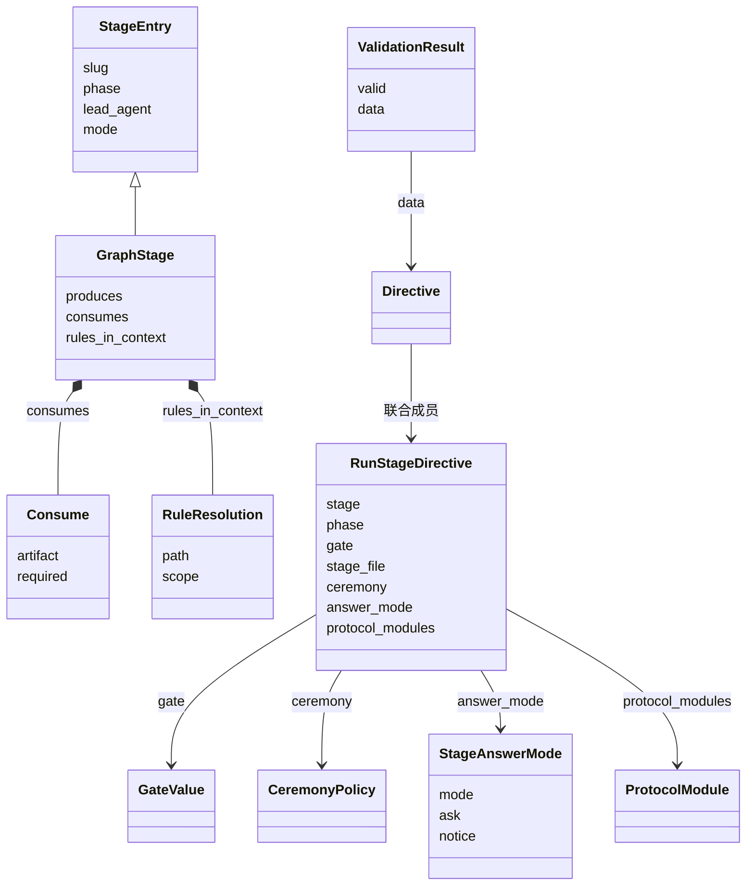

# 类型关系

这份只描述不运行时的类型关系。
调用顺序在执行路径。
核对在每张图下。

这条路径上彼此引用的自定义类型，加上引擎交出去的 directive 合同，画在下面。关系只有扩展、包含和引用。

- `GraphStage` 扩展 `StageEntry`。`core/tools/aidlc-graph.ts:190` 【事实】
- `GraphStage` 包含 `Consume`，字段 `consumes`。`core/tools/aidlc-graph.ts:207` 【事实】
- `GraphStage` 包含 `RuleResolution`，字段 `rules_in_context`。`core/tools/aidlc-graph.ts:244` 【事实】
- `Directive` 引用 `RunStageDirective`，作为 `DirectivePayload` 的联合成员。`core/tools/aidlc-directive.ts:994-1013` 【事实】
- `RunStageDirective` 引用 `GateValue`，字段 `gate`。`core/tools/aidlc-directive.ts:325` 【事实】
- `RunStageDirective` 引用 `CeremonyPolicy`，字段 `ceremony`。`core/tools/aidlc-directive.ts:451` 【事实】
- `RunStageDirective` 引用 `StageAnswerMode`，字段 `answer_mode`。`core/tools/aidlc-directive.ts:454` 【事实】
- `RunStageDirective` 引用 `ProtocolModule`，字段 `protocol_modules`。`core/tools/aidlc-directive.ts:482` 【事实】
- `ValidationResult` 引用 `Directive`，字段 `data`（`valid` 为 true 时）。`core/tools/aidlc-directive.ts:1022-1024` 【事实】

> 核对：`StageEntry` 的声明在 `core/tools/aidlc-lib.ts:569`。`Consume` 在 `core/tools/aidlc-graph.ts:153`。`RuleResolution` 在 `core/tools/aidlc-graph.ts:165`。`GateValue` 在 `core/tools/aidlc-directive.ts:56`。`CeremonyPolicy` 在 `core/tools/aidlc-lib.ts:40045`。`StageAnswerMode` 在 `core/tools/aidlc-lib.ts:40390`。`ProtocolModule` 在 `core/tools/aidlc-directive.ts:101`。以上为【事实】。

> 推断：`GraphStage` 和 `RunStageDirective` 在类型声明上没有互相指向。把节点填成工单的是 `buildRunStageDirective`，参数类型是 `GraphStage`，返回类型是 `RunStageDirective`。依据是函数签名，所以图上没有这条线。
> `core/tools/aidlc-orchestrate.ts:10140-10154` 【事实】

> 核对：没有实体关系图。工作记录是项目里的 markdown，调查把它标成外部依赖。这条路径没有模块自己持有的表、集合，或带标识并且会保存的聚合类型。`stage-graph.json` 是编译输入，`loadGraph` 把它读成 `GraphStage` 数组。`SensorResolution`、`PresentGateDirective`，以及 swarm 和计划批准相关类型属于暂不展开，没有画进这张图。
> `core/tools/aidlc-graph.ts:1401-1407` `loadGraph` 【事实】
